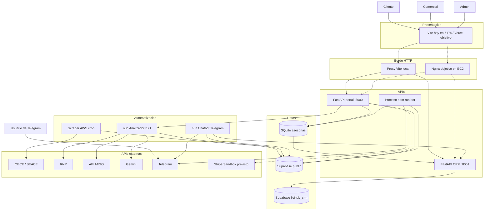
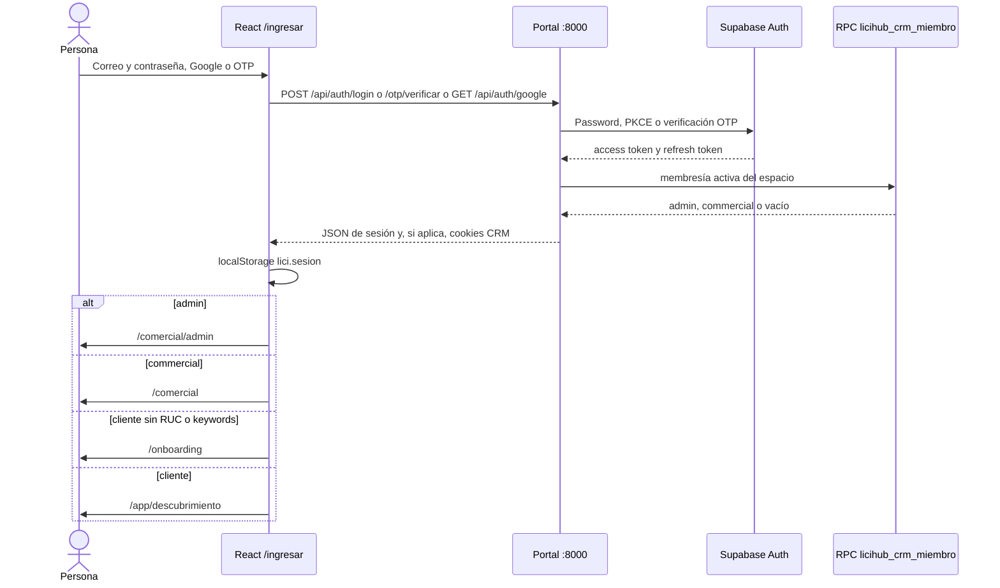
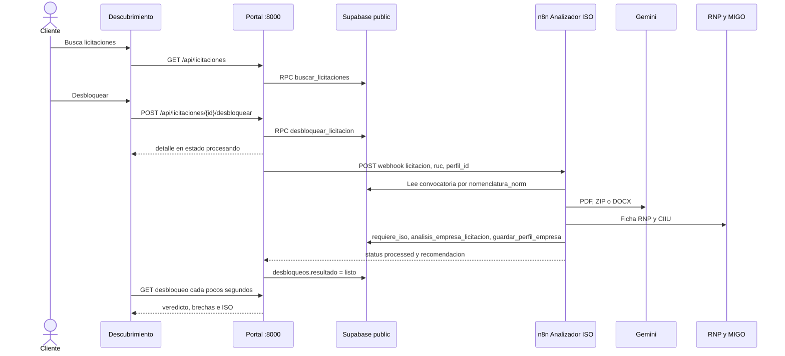
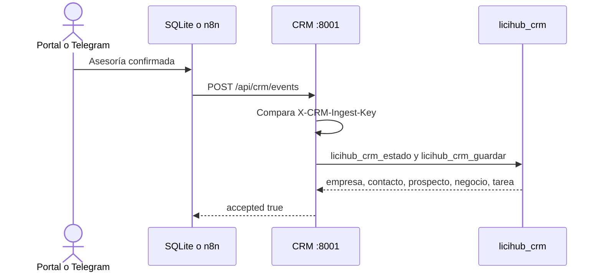

# Arquitectura de LiciHub

Documento de arquitectura de extremo a extremo. Lo que está en este repositorio se cita contra `portal/`, `crm/` y `portal/n8n/`. Lo que solo existe como operación externa o como topología aún no versionada se marca así. No hay claves, tokens ni URLs de proxy.

## 1. Resumen ejecutivo y stack

LiciHub es una plataforma de licitaciones públicas peruanas con tres superficies: el portal del cliente, el CRM comercial montado en `/comercial`, y dos automatizaciones en n8n (análisis ISO y chatbot de Telegram). React no habla con Supabase. Las dos APIs FastAPI son el único camino hacia la base.

Versiones declaradas en el repositorio, no versiones instaladas en una máquina:

| Capa | Tecnología declarada | Puerto en local | Responsabilidad |
|---|---|---|---|
| Monorepo | Node `>=24` (`package.json` raíz, versión `0.2.0`) | — | `npm start` levanta portal, CRM y el origen unificado |
| Portal UI | React `^19.2.8`, React Router `^7.18.4`, Vite `^8.3.0`, TypeScript `~6.0.2`, Tailwind `^4.3.3` | `5173` solo portal; `5174` unificado con HTTPS local | Descubrimiento, onboarding, perfil, desbloqueos y el shell del CRM |
| CRM UI | Las mismas librerías de React/Vite, empaquetadas en `crm/` | Se sirve dentro de `5174/comercial` cuando `VITE_CRM_BASE=/comercial` | Tablero, negocios, cotizaciones, catálogo y administración |
| API portal | FastAPI `>=0.118`, Uvicorn `>=0.37`, httpx `>=0.28`, pydantic-settings `>=2.11`, python-telegram-bot `>=22.5` | `127.0.0.1:8000` | Auth, licitaciones, desbloqueos, perfil, alertas y cola hacia el CRM |
| API CRM | FastAPI `>=0.118,<1`, Uvicorn `>=0.37,<1`, httpx `>=0.28,<1` | `127.0.0.1:8001` | Estado comercial, comandos, equipo y recepción `POST /api/crm/events` |
| Bot del portal | Mismo proceso Python, `npm run bot` | Sin puerto HTTP | Alertas y asesoría de cuentas ya vinculadas |
| Datos | Supabase Auth + PostgREST. Esquema `public` y esquema `licihub_crm` | — | Convocatorias, perfiles y el libro comercial |
| Cola | SQLite `portal/backend/data/asesorias.sqlite3` | Archivo local | Outbox de asesorías entre el portal y el CRM |
| n8n | Flujos versionados en `portal/n8n/` | Fuera de este repo | Análisis ISO y chatbot público |

`npm start` (`scripts/iniciar.mjs`) arranca Uvicorn del portal en `8000`, Uvicorn del CRM en `8001` y Vite en `https://127.0.0.1:5174` con `LICIHUB_UNIFIED=1`. El proxy de Vite envía `/api/crm` a `8001` y el resto de `/api` a `8000`, en ese orden (`portal/vite.config.ts`).

## 2. Diagrama global

El scraper, Nginx, Vercel, el host de n8n y Stripe no tienen código de despliegue en este repositorio. El diagrama los incluye porque forman la topología operativa o prevista. Las flechas continuas son las que el código de este repo ejecuta hoy en local.

## 3. Flujos críticos

### Flujo A — Autenticación unificada y roles

El único ingreso de la interfaz es `/ingresar`. El portal guarda la sesión de Supabase Auth en `localStorage` bajo la clave `lici.sesion` (`portal/src/lib/auth.ts`): access token, refresh token y usuario. Esa sesión no es una cookie. Las cookies `HttpOnly` existen solo para el CRM y solo si el rol es `admin` o `commercial`.

`rol_comercial` llama a la RPC `licihub_crm_miembro` con `CRM_WORKSPACE_ID`. Si no hay espacio configurado, si la RPC falla o si el miembro no está activo, el rol es `cliente`. El registro no inserta filas en `licihub_crm.miembros`.

Contratos verificados en `portal/backend/app/auth.py` y `portal/src/pages/IngresarPage.tsx`:

| Camino | Entrada | Detalle |
|---|---|---|
| Contraseña | `POST /api/auth/login` | Token de Supabase y rol |
| Registro | `POST /api/auth/registro` | Alta en Auth con `email_confirm` y fila en `perfiles`. No crea miembro del CRM |
| Google | `GET /api/auth/google` y `/callback` | PKCE. Cookies `lici_pkce` y `lici_volver`, `HttpOnly`, `Secure`, `SameSite=Lax`, path `/api/auth/google`, 10 minutos |
| OTP | `POST /api/auth/otp` y `/otp/verificar` | Mismo redirect de rol. No crea miembros |
| Restablecer | `POST /api/auth/recuperar` y `/restablecer` | Vuelve a `/ingresar/restablecer` |
| Ticket | `POST /api/auth/ticket` | Canje en memoria, 2 minutos, para el retorno del navegador |

Cookies del CRM, solo admin y commercial: `lici_crm_session` (máximo 1 hora) y `lici_crm_refresh` (14 días). Ambas `HttpOnly`, `Secure`, `SameSite=Strict`, path `/api/crm`. Un cliente borra esas cookies. `POST /api/auth/logout` limpia `localStorage` y las cookies.

Un comercial que pida una ruta `/comercial/admin` vuelve a `/comercial`. Sin sesión, `/comercial` va a `/ingresar?volver=`.

### Flujo B — Descubrimiento, desbloqueo y análisis ISO

El cupo sale de `perfiles.limite_desbloqueos`. El comentario del módulo indica 5 como valor de producto; el código usa el entero guardado en el perfil. Repetir el mismo desbloqueo no gasta otro cupo. Si ya existe análisis para ese RUC y esa convocatoria, no se vuelve a llamar a n8n, salvo un reintento explícito (`POST .../reanalizar`).

Sin `N8N_WEBHOOK_URL` el desbloqueo queda en `sin_analisis`. Con webhook, el portal espera hasta `N8N_TIMEOUT_SEC` (300). El flujo versionado es `portal/n8n/analizador-iso-licitaciones.json`, webhook `desbloquear-licitacion-gemini`. Busca por `nomenclatura_norm`, descarga las bases, llama a Gemini `gemini-3.5-flash-lite`, consulta RNP y MIGO, hace `PATCH` de `convocatorias.requiere_iso` y upsert de `analisis_empresa_licitacion` por `(ruc, convocatoria_id)`. La ficha `DetalleDesbloqueo.tsx` pinta veredicto, resumen, requisitos ISO, encaje, brechas, normas y mensaje comercial.

`GET /api/empresas/{ruc}` exige sesión (`401` sin `Authorization: Bearer`). Esa consulta también puede pasar por el flujo alterno `portal/n8n/registrar-empresa.json` (`POST /webhook/registrar-empresa`), que no es el camino del desbloqueo.

### Flujo C — Ingesta al CRM

El CRM solo acepta en `POST /api/crm/events` orígenes `Lici` y `Telegram`, y tipos `advice` o `quote`. La clave va en `X-CRM-Ingest-Key`. Sin clave configurada responde `503` con código `crm_ingest_disabled`. Clave distinta: `401`. El `requestId` se guarda como `lici:{requestId}` y una repetición no crea otro negocio.

Qué crea `receive_intake` cuando `kind` es `advice` o `quote`:

1. Empresa, reutilizada si el RUC ya existe en el espacio.
2. Contacto, si hay nombre, correo o teléfono. Si el contacto ya existe por RUC y correo y no tenía teléfono, el teléfono nuevo se completa.
3. Prospecto con servicio, origen, licitación y notas.
4. Negocio en etapa `new`, si no hay otro abierto del mismo servicio.
5. Tarea «Realizar primera atención» a un día.

Dos entradas:

| Entrada | Dónde vive | Cómo llega al CRM |
|---|---|---|
| Portal y `npm run bot` | SQLite `asesorias.sqlite3` | Un bucle del portal reintenta cada 30 s. La espera crece `15 * 2^n` segundos, tope 1 hora |
| Chatbot de `portal/n8n/chatbot-telegram-licihub.json` | Memoria del workflow de n8n | `POST` directo, sin SQLite. `origin` Telegram. `kind` `advice` o `quote` según elija la persona |

El esquema `008` admite también `WhatsApp`, `Referido`, `Campaña`, `Manual` y `Partner` como origen de filas. El endpoint de eventos no los acepta: solo `Lici` y `Telegram`.

### Flujo D — Operación comercial y administración

Cualquier miembro activo lee `GET /api/crm/session` y `GET /api/crm/state` y escribe con `POST /api/crm/commands`. El estado viaja por las RPC `licihub_crm_estado` y `licihub_crm_guardar`. En modo `demo` el CRM usa SQLite local y no exige login. En modo `supabase` exige HTTPS y cookies de sesión.

Operaciones de comando presentes en el dominio: `intake`, `stage`, `deal_details`, `assign_owner`, `activity`, `task`, `complete_task`, `contact`, `contact_create`, `contact_edit`, `convert`, `quote`, `quote_status`, `product`, `import_iso`, `property_create`, `property_archive`, `property_set`.

Solo `admin` ejecuta `product`, `import_iso` y `property_*` (`403` en caso contrario). Cotizaciones nuevas exigen la migración `006` (esquema versión 2). Propiedades exigen la `010` (versión 3).

Equipo, migración `011`, solo admin activo:

| Método | Ruta | Efecto |
|---|---|---|
| GET | `/api/crm/team` | Lista `licihub_crm.miembros` del espacio |
| POST | `/api/crm/team` | Alta por correo ya existente en Auth |
| POST | `/api/crm/team/acceso` | Cambia rol o `activo`. El único admin activo no puede quitarse el acceso (`409`) |

En modo Supabase, los responsables que ofrece la ficha son los miembros activos. En modo demo siguen los dos nombres de prueba, porque no hay `auth.users`.

La interfaz de admin vive en `/comercial/admin`, `/comercial/admin/equipo` y `/comercial/admin/propiedades`. El enlace de equipo solo se muestra al rol `admin`.

## 4. Datos y contrato entre esquemas

`public` es el dominio del portal y del scraper. `licihub_crm` es el libro comercial. El esquema comercial no está expuesto a PostgREST: el CRM entra por funciones `security definer` concedidas a `service_role`.

Llaves que cruzan esquemas, tomadas de `002_relational_tables.sql`:

| Desde | Hacia | Relación |
|---|---|---|
| `licihub_crm.empresas.ruc_proveedor` | `public.proveedores.ruc` | Opcional. Si existe, debe ser igual a `empresas.ruc` |
| `licihub_crm.contactos.perfil_portal_id` | `public.perfiles.id` | Opcional |
| `licihub_crm.prospectos.convocatoria_id` | `public.convocatorias.id` | Opcional |
| `licihub_crm.prospectos.analisis_id` | `public.analisis_empresa_licitacion.id` | Opcional |
| `licihub_crm.miembros.usuario_id` | `auth.users.id` | Obligatoria |

`analisis_empresa_licitacion` se lee por `ruc` y `convocatoria_id`. El flujo de n8n versionado hace el upsert con esa pareja.

RPC del CRM en `public`, llamadas solo con la clave de servidor:

| Función | Migración | Uso |
|---|---|---|
| `licihub_crm_miembro` | 003 | Rol activo de un usuario |
| `licihub_crm_estado` | 003 | Foto del espacio |
| `licihub_crm_guardar` | 003 | Aplica el diff y sube la revisión |
| `licihub_crm_equipo` | 011 | Lista miembros con correo de Auth |
| `licihub_crm_guardar_miembro` | 011 | Alta o cambio de rol y `activo` |

RPC y jobs del esquema `public` no están versionados en este repositorio. `portal/docs/DOCUMENTACION.md` describe, y el backend llama, estas piezas:

| Objeto | Uso en código o en la doc |
|---|---|
| `buscar_licitaciones` | Portal y chatbot n8n |
| `historial_empresa` | Historial del perfil |
| `guardar_perfil_empresa` | Portal y analizador ISO |
| `desbloquear_licitacion` | Cupo atómico del desbloqueo |
| `licihub_crm_miembro` | Rol en el login |

La misma documentación lista cuatro tareas `pg_cron`, no tres: `abierta` cada 15 minutos, clasificación CIIU cada 10 minutos, texto de búsqueda cada 5 minutos y amplitud CIIU a diario. El trigger `trg_sync_convocatorias_licihub` no aparece en el repositorio. Los triggers que sí describe la doc normalizan nomenclatura, objeto y departamento, y marcan reclasificación de CIIU.

### Migraciones del CRM

| Archivo | Impacto |
|---|---|
| 001 | Piloto JSONB en `public.crm_workspaces`. No se usa en una instalación relacional nueva |
| 002 | Crea `licihub_crm` en español: espacios, miembros, empresas, contactos, negocios, prospectos, tareas, actividades, cotizaciones |
| 003 | RPC de lectura, guardado y membresía. Revoca el esquema a `anon` y `authenticated` |
| 004 | Ejemplo de provisión de un espacio. No debe ejecutarse si el `CRM_WORKSPACE_ID` ya existe |
| 005 | Renombra un esquema inglés ya aplicado. No borra filas |
| 006 | Varias cotizaciones por negocio, eventos de estado e impuestos. Sube el esquema a la versión 2 |
| 007 | Inserta el catálogo ISO en un espacio cuyo UUID está escrito en el archivo |
| 008 | Amplía el check de `origen` para incluir Telegram y el resto de canales |
| 009 | `negocios.prioridad` y `negocios.cierre_esperado` |
| 010 | Tabla `propiedades` y columna `campos` en empresas, contactos y negocios. Versión 3 |
| 011 | RPC de listado y upsert de miembros. No borra filas |

## 5. Seguridad y acceso

React solo llama a `/api/*` del mismo origen. Las claves de Supabase, de MIGO, de Gemini, de Telegram y de ingesta viven en el servidor o en credenciales de n8n.

PostgREST, en `portal/backend/app/supabase.py` y en `crm/backend/repository.py`: la clave va en `apikey`. `Authorization: Bearer` se añade solo si la clave empieza por `eyJ`. Una clave `sb_secret` no lleva ese encabezado. El chatbot versionado sigue la misma regla: sus nodos HTTP de Supabase declaran `apikey` y no declaran `Authorization`.

| Control | Dónde | Resultado |
|---|---|---|
| Sesión del portal | `Authorization: Bearer` leído de `lici.sesion` | `401` en `/api/empresas/{ruc}` y en el resto de rutas con `usuario_actual` |
| Caché del token | Memoria del proceso, 60 s (`_CACHE_SEG`) | Un token revocado puede seguir válido hasta un minuto |
| Cookies CRM | Path `/api/crm`, `HttpOnly`, `Secure`, `SameSite=Strict` | El JavaScript del navegador no las lee |
| Origen del CRM | Mutaciones exigen `Origin == CRM_ORIGIN`, salvo `/api/crm/events` | `403` si el origen no coincide |
| Host del CRM | `TrustedHostMiddleware` admite localhost y el host de `CRM_ORIGIN` | Otro host recibe rechazo de Starlette |
| Rol | `admin` frente a `commercial` | `403` en catálogo, propiedades y equipo |
| Último admin | `POST /api/crm/team/acceso` | `409` si el cambio dejaría el espacio sin admin activo |
| Integración | `X-CRM-Ingest-Key` comparada en tiempo constante | `401` o `503` |
| Tamaño | Cuerpo de mutación del CRM, 64 KB | `413` |
| Modo demo | CRM sin Supabase | Solo desde `127.0.0.1` |

`GET /api/health` del portal no exige sesión. Devuelve si existen las tablas de desbloqueo y si Telegram, n8n y el CRM están configurados, sin mostrar los secretos. El CRM no publica un `/api/health`.

## 6. Despliegue local, producción prevista y CI/CD

Hoy el repositorio solo automatiza el arranque local. No hay `vercel.json`, workflows de GitHub Actions ni configuración de Nginx. Esas piezas son la topología objetivo, no un pipeline ya commiteado.

| Variable | Local verificado | Producción prevista |
|---|---|---|
| Origen del navegador | `https://127.0.0.1:5174` | Dominio de Vercel, un solo origen |
| `API_URL` / portal | `http://127.0.0.1:8000` | `127.0.0.1:8000` detrás de Nginx |
| `CRM_API_URL` | `http://127.0.0.1:8001` | `http://127.0.0.1:8001` desde el portal de la misma EC2 |
| `CRM_ORIGIN` | `https://127.0.0.1:5174` | URL HTTPS pública del frontend. Tiene que coincidir con el host admitido |
| `PUBLIC_ORIGIN` | Vacío usa el de la petición; el ejemplo cita `5174` | URL pública de Vercel, para Google y el correo de restablecer |
| `CORS_ORIGINS` | `http://localhost:5173` en el ejemplo | El origen de Vercel, si alguna llamada no pasa por el rewrite |
| `SUPABASE_URL` y `SUPABASE_SECRET_KEY` | Solo en `portal/backend/.env` | Misma pareja en la EC2. Nunca en Vercel |
| `CRM_SUPABASE_URL`, `CRM_SUPABASE_SECRET_KEY`, `CRM_WORKSPACE_ID` | Solo en `crm/backend/.env` | La misma EC2. El workspace es el de `011` y el login |
| `CRM_INGEST_KEY` | Igual en los dos `.env` | Igual en portal, CRM y el nodo Config del chatbot |
| `N8N_WEBHOOK_URL` | Vacío desactiva el análisis | `https://<HOST_N8N>/webhook/desbloquear-licitacion-gemini` |
| `CRM_OUTBOX_FILE` | `portal/backend/data/asesorias.sqlite3` | Disco persistente de la EC2. Hay que respaldarlo |
| `VITE_CRM_BASE` | `/comercial` en el arranque unificado | El build de Vercel debe recibir el mismo valor |
| Telegram del portal | `TELEGRAM_BOT_TOKEN` | Proceso `npm run bot` aparte, en la misma máquina o no |
| Chatbot n8n | Placeholders `TU_*` en el JSON | Credencial de Telegram y el nodo Config, en el n8n de `hub.buhbuhbuh.com` |

Rewrite objetivo, equivalente al proxy que ya tiene Vite: `/api/crm` hacia el CRM y `/api` hacia el portal, mismo host que el HTML. Así `SameSite=Strict` de las cookies del CRM sigue aplicando. El access token del portal seguiría en `localStorage` aunque el rewrite exista.

CI/CD previsto, todavía sin archivos en el repo:

1. GitHub Actions corre `npm run test:portal`, `npm run test:crm` y `npx tsc -b --noEmit` en `portal/` y en `crm/`.
2. El job de despliegue entra por SSH a la EC2, actualiza el código y reinicia los dos Uvicorn. No reinicia solo: ambos leen `.env` al arrancar.
3. Vercel despliega el build del portal con `VITE_CRM_BASE=/comercial`.
4. n8n no entra en ese pipeline: los JSON se importan a mano y quedan activos en el servidor propio.

Salud que sí existe hoy:

| Señal | Dónde |
|---|---|
| `GET /api/health` | Portal. `ok`, tablas de desbloqueo, y si Telegram, n8n y CRM están configurados |
| Logs de Uvicorn | Salida de `npm start` o del servicio en la EC2 |
| Cron del scraper | Syslog de la EC2. El scraper no está en este repo |
| Ejecuciones de n8n | Historial del servidor n8n. El flujo ISO responde `processed`, `cached`, `too_large`, `not_supported` o `not_found` |
| Cola comercial | Filas de `asesorias.sqlite3` y el log «No se pudo procesar la cola comercial» |

Stripe Checkout en sandbox, para recargar `perfiles.limite_desbloqueos`, no tiene rutas, tablas ni SDK en este repositorio. El cupo hoy es el entero que ya está en el perfil.

## 7. Decisiones

### ADR-1. FastAPI como BFF

Contexto. El navegador necesita licitaciones, perfil y el CRM, y la clave de Supabase no puede vivir en el cliente. `licihub_crm` ni siquiera está en la API pública de PostgREST.

Decisión. React llama solo a FastAPI. El portal y el CRM usan la clave de servidor y las RPC.

Consecuencia. Hay un proceso que validar y desplegar por cada API. A cambio, el rol, el cupo y la ingesta se deciden en el servidor.

### ADR-2. Dos servicios detrás de un proxy

Contexto. El portal y el CRM tienen sesiones, esquemas y ciclos de vida distintos. El CRM rechaza mutaciones cuyo `Origin` no sea `CRM_ORIGIN`.

Decisión. Portal en `:8000` y CRM en `:8001`. Un proxy presenta un solo origen.

Consecuencia. Hay que reiniciar el proceso correcto y mantener `CRM_INGEST_KEY` igual en ambos. El fallo de uno no tira al otro.

### ADR-3. Un origen para las cookies

Contexto. `lici_crm_session` es `SameSite=Strict` y `Secure`, con path `/api/crm`. Un frontend en otro host no enviaría esa cookie.

Decisión. Vite, y en producción el rewrite de Vercel, sirven el HTML y las dos APIs bajo el mismo host.

Consecuencia. No hace falta abrir CORS para el uso normal. `CRM_ORIGIN` y `PUBLIC_ORIGIN` tienen que ser esa URL HTTPS.

### ADR-4. Outbox en SQLite

Contexto. La asesoría del portal no puede perderse si el CRM está caído, y no hay un bus de mensajes en la instalación.

Decisión. La solicitud se escribe en SQLite antes de responder al usuario. El proceso del portal reintenta cada 30 segundos.

Consecuencia. El archivo tiene que vivir en disco persistente y respaldarse. Dos procesos del portal contra el mismo archivo necesitan el `timeout` de SQLite que el código ya usa.

### ADR-5. ISO y Telegram fuera del proceso web

Contexto. Leer un PDF con Gemini y sostener un diálogo de Telegram bloquean el request del portal durante minutos y dependen de credenciales distintas.

Decisión. El analizador y el chatbot son flujos de n8n. El portal solo dispara el webhook y guarda el resultado. El chatbot escribe el lead en `/api/crm/events`.

Consecuencia. n8n se opera aparte del `git pull` de la EC2. El chatbot de n8n no sustituye a `npm run bot`: uno atiende a quien no tiene cuenta; el otro avisa a cuentas ya vinculadas.

### ADR-6. Los dos backends en la EC2 del scraper

Contexto. El scraper ya paga una instancia. Sumar otra máquina para dos procesos Uvicorn que hablan por localhost no cambia el producto.

Decisión. Portal `:8000`, CRM `:8001` y el archivo SQLite quedan en esa EC2, detrás de Nginx. El HTML sale por Vercel.

Consecuencia. El costo de cómputo adicional previsto es cero. La RAM, el disco del outbox y el cron del scraper compiten en la misma máquina. Un reinicio de la EC2 corta las dos APIs y la ingesta.

## 8. Riesgos y mitigación

| Riesgo | Evidencia | Mitigación |
|---|---|---|
| RAM compartida en la EC2 | Scraper, dos Uvicorn, bot y Nginx en una sola instancia. No hay límite en el repo | Medir la instancia antes del pico de cron. Dejar el análisis pesado en n8n, que ya está en otro servidor |
| Estado del chatbot | `chatbot-telegram-licihub.json` guarda la conversación en la memoria del workflow | Un solo worker de n8n para la demo. Una tabla en Supabase cuando haya más de un proceso |
| Caché de sesión de 60 s | `_CACHE_SEG = 60` en `auth.py` | Aceptado para no pegarle a Auth en cada request. Un cierre de sesión del portal borra el token local; la caché del servidor cae al minuto |
| Caché de keywords de 300 s | `CACHE_TTL_SEC` | No es la sesión. Afecta sugerencias de CIIU, no el rol |
| Claves en exports de n8n | El JSON del analizador en el repo usa placeholders. Un export suelto puede traer la clave de Gemini en la URL | Importar solo `portal/n8n/`. Rotar cualquier clave que haya salido en un export. No commitear el nodo Config relleno |
| PDF largo | Timeout de n8n de 300 s. Archivos de más de 60 MB responden `too_large` | La ficha ya ofrece reintento. El análisis cacheado por licitación evita una segunda lectura del archivo |
| `CRM_ORIGIN` distinto del host público | `TrustedHostMiddleware` y el chequeo de `Origin` | Antes de cortar tráfico, fijar `CRM_ORIGIN` y `PUBLIC_ORIGIN` a la URL HTTPS real y reiniciar el CRM |
| Outbox en disco local | La cola no está en Supabase | Volumen persistente y copia del sqlite. No usar un disco efímero de despliegue |
| Sesión del portal en `localStorage` | `lici.sesion` guarda el access token donde JavaScript puede leerlo | El rewrite no convierte esa sesión en cookie. Si el objetivo es `HttpOnly` también para el cliente, hay que cambiar `auth.ts` antes de tratar el portal como cookie-only |
| Migración 007 | El catálogo apunta a un UUID de espacio escrito en el SQL | Confirmar que ese UUID es `CRM_WORKSPACE_ID` antes de ejecutarlo en producción |
| Stripe | No hay código | No prometer recarga de cupos hasta existir Checkout, webhook firmado y el update de `limite_desbloqueos` |
| `pg_cron` y `trg_sync` | No están en el repo. La doc lista cuatro jobs | Versionar el SQL de `public` o aceptar que la operación de la base vive fuera de este git |
| WhatsApp | El check de origen del CRM lo permite en tablas y lo rechaza en `/api/crm/events` | No conectar un canal WhatsApp a ese endpoint sin ampliar la lista de orígenes |

## Inconsistencias que conviene cerrar antes de producción

1. La topología Vercel + Nginx + GitHub Actions + Stripe no está en el repositorio. Desplegarla ahora sería hacerlo sin el pipeline que la sostiene.
2. La sesión del cliente sigue en `localStorage`. Las cookies `HttpOnly` cubren al CRM, no al portal.
3. `POST /api/crm/events` rechaza cualquier origen que no sea `Lici` o `Telegram`, aunque la migración `008` acepte más canales.
4. El CRM no tiene endpoint de salud. El monitoreo de `:8001` no puede usar `/api/health`.
5. `007_catalogo_iso.sql` está atado a un espacio concreto. Ejecutarlo en otro workspace falla a propósito.
6. El trigger `trg_sync_convocatorias_licihub` y el SQL de `pg_cron` no se pueden revisar desde este git. La documentación interna describe cuatro jobs, no tres.
