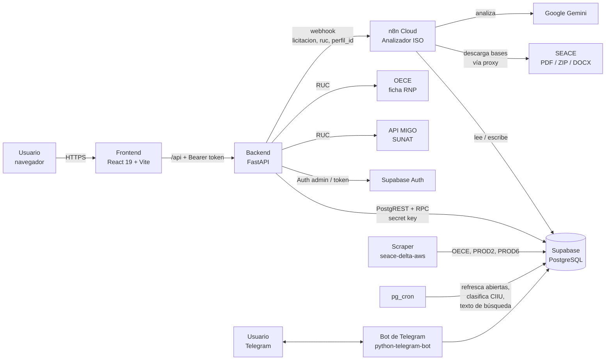
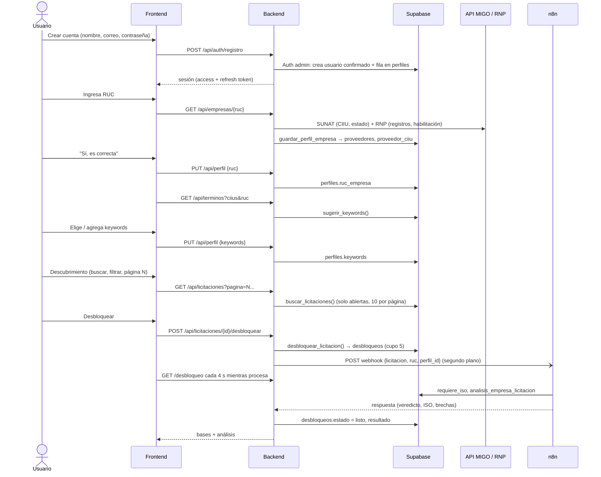
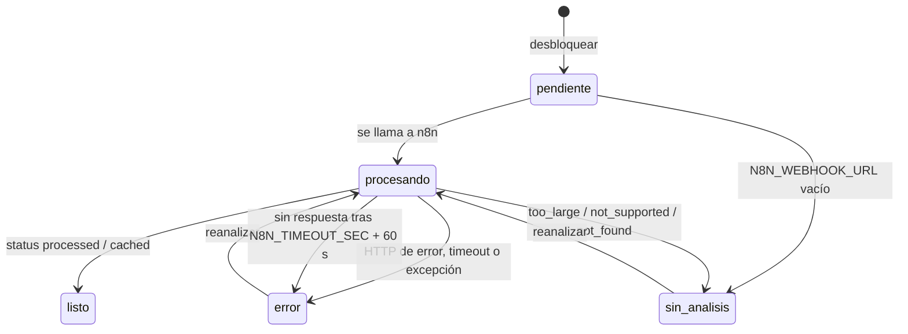
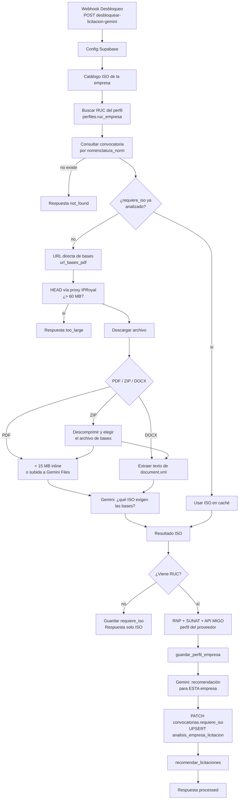

# Lici — Documentación del sistema

Lici es una plataforma de inteligencia para contrataciones del Estado peruano (SEACE). A partir del **RUC** de una
empresa identifica su rubro (actividades **CIIU** de SUNAT), le sugiere **keywords** basadas en los ítems **CUBSO**
que más se licitan en su rubro y en su historial de postulaciones, le muestra **solo las licitaciones abiertas** que
le calzan (paginadas) y le permite **desbloquear 5 licitaciones** por cuenta para ver las bases administrativas y un
**análisis con IA** (ISO exigidas en las bases + recomendación personalizada) que se genera en **n8n**.

---

## Índice

1. [Arquitectura general](#1-arquitectura-general)
2. [Tecnologías y herramientas](#2-tecnologías-y-herramientas)
3. [Estructura del repositorio](#3-estructura-del-repositorio)
4. [Flujo del usuario](#4-flujo-del-usuario)
5. [Cómo se recomienda (keywords y licitaciones)](#5-cómo-se-recomienda)
6. [Desbloqueo e integración con n8n](#6-desbloqueo-e-integración-con-n8n)
7. [Backend (FastAPI)](#7-backend-fastapi)
8. [API HTTP](#8-api-http)
9. [Frontend (React)](#9-frontend-react)
10. [Base de datos (Supabase)](#10-base-de-datos-supabase)
11. [Qué tablas y columnas llena cada acción](#11-qué-tablas-y-columnas-llena-cada-acción)
12. [APIs y servicios externos](#12-apis-y-servicios-externos)
13. [Bot de Telegram](#13-bot-de-telegram)
14. [Configuración y puesta en marcha](#14-configuración-y-puesta-en-marcha)
15. [Seguridad y manejo de errores](#15-seguridad-y-manejo-de-errores)
16. [Consultas SQL útiles](#16-consultas-sql-útiles)
17. [Limitaciones conocidas y pendientes](#17-limitaciones-conocidas-y-pendientes)
18. [Glosario](#18-glosario)

---

## 1. Arquitectura general



| Componente | Responsabilidad |
|---|---|
| **Frontend** (React) | Landing, registro/login, onboarding conversacional (RUC → keywords → alertas), Descubrimiento (buscador, paginación, desbloqueo). |
| **Backend** (FastAPI) | Única puerta a la base: cuentas, perfil, búsqueda, sugerencias, desbloqueos, llamada a n8n. El navegador **nunca** ve la clave de Supabase. |
| **Supabase** | PostgreSQL con las convocatorias, el catálogo CUBSO↔CIIU, perfiles, desbloqueos y funciones SQL que calculan la afinidad. Supabase Auth para las cuentas. |
| **n8n** | Flujo "Analizador ISO Licitaciones": descarga las bases de la licitación, las lee con Gemini y genera la recomendación para la empresa. |
| **Scraper** (repo aparte `seace-delta-aws`) | Carga y actualiza convocatorias, ítems, documentos, cronogramas y postulaciones desde OECE, PROD2 y PROD6. |
| **pg_cron** | Tareas periódicas dentro de la base (abiertas, clasificación CIIU, índice de texto, amplitud CIIU). |
| **Bot de Telegram** | Alertas de licitaciones nuevas que calzan con el perfil. |

---

## 2. Tecnologías y herramientas

### Frontend
| Tecnología | Uso |
|---|---|
| **React 19** (componentes de función y hooks) | SPA |
| **TypeScript 6** | Lenguaje |
| **Vite 8** | Servidor de desarrollo y build |
| **React Router 7** | Rutas y guard de sesión (`RequireAuth`) |
| `fetch` + `lib/api.ts` | Token de sesión, renovación automática y `AbortController` para cancelar búsquedas anteriores |
| **Tailwind CSS 4** | Estilos con tokens del tema (`--color-primary`, etc.) en `src/index.css` y clases compartidas en `src/lib/ui.ts` |
| **Oxlint** | Lint (`npm run lint`) |
| `vite.config.ts` (`server.proxy`) | En desarrollo `/api` → `http://localhost:8000` |

### Backend
| Tecnología | Uso |
|---|---|
| **Python 3.12+** | Lenguaje |
| **FastAPI** | API HTTP, validación con Pydantic, dependencias (`Depends`) |
| **Uvicorn** | Servidor ASGI |
| **httpx** (async) | Cliente HTTP para Supabase, API MIGO, OECE, n8n, Telegram |
| **pydantic-settings** | Configuración desde `backend/.env` |
| **email-validator** | Validación de correos (`EmailStr`) |
| **python-telegram-bot** (job-queue) | Bot y alertas periódicas |

### Datos e infraestructura
| Tecnología | Uso |
|---|---|
| **Supabase** (PostgreSQL 15+) | Base de datos, API REST automática (PostgREST), Auth |
| Extensiones | `pg_cron` (tareas), `pg_trgm` (índice de texto), `pgcrypto`, `uuid-ossp` |
| **n8n Cloud** | Orquestación del análisis con IA |
| **Google Gemini** (API `generativelanguage`) | Lectura de bases y recomendación |
| **IPRoyal** (proxy residencial Perú) | Descarga de archivos del SEACE desde n8n |

### Herramientas de desarrollo
VS Code, Vite (`npm run dev`, `npm run build`), Oxlint, entorno virtual Python (`backend/.venv`), Supabase
Dashboard (SQL Editor, Table Editor) y MCP de Supabase.

---

## 3. Estructura del repositorio

```
interfaz_licitigo/
├── src/                           Frontend React
│   ├── main.tsx                   Monta la app: BrowserRouter + OnboardingProvider
│   ├── App.tsx                    Rutas y guard
│   ├── index.css                  Tailwind + tokens del tema y estilos base
│   ├── lib/
│   │   ├── api.ts                 Cliente del backend + token Bearer, renovación y mensajeError()
│   │   ├── auth.ts                Sesión (localStorage) y useSesion()
│   │   ├── ui.ts                  Clases compartidas (botones, pills, tarjetas, diálogos)
│   │   ├── formato.ts             Montos en soles
│   │   └── fuentes.ts             Etiquetas de la fuente (OECE, PROD2, PROD6)
│   ├── context/OnboardingContext.tsx  Estado del onboarding
│   ├── types/models.ts            Interfaces TypeScript (contratos con la API)
│   ├── data/pipeline.ts           Datos de ejemplo de "Mi equipo"
│   ├── pages/                     Landing, Ingresar, Onboarding, Descubrimiento, MisDesbloqueos, Perfil, Equipo
│   └── components/                Topbar, KpiCard, RadarCard, DetalleDesbloqueo, EnlaceTelegram, RequireAuth
├── backend/
│   ├── app/
│   │   ├── main.py                API FastAPI (endpoints, validación, errores)
│   │   ├── auth.py                Cuentas con Supabase Auth
│   │   ├── desbloqueos.py         Cupo de desbloqueos + llamada a n8n
│   │   ├── licitaciones.py        Búsqueda, keywords sugeridas, estadísticas
│   │   ├── empresa.py             Perfil por RUC y guardado en la base
│   │   ├── fuentes.py             API MIGO y ficha RNP
│   │   ├── texto.py               Normalización de texto y nombres CUBSO
│   │   ├── supabase.py            Cliente PostgREST mínimo
│   │   ├── suscripciones.py       Suscripciones de Telegram
│   │   ├── bot.py                 Bot de Telegram
│   │   ├── config.py              Variables de entorno
│   │   └── data/ciiu_rev4.json    Títulos CIIU Rev. 4
│   ├── requirements.txt
│   ├── .env.example
│   └── README.md
├── n8n/                           Flujos n8n para importar (Analizador ISO, Registrar Empresa)
├── docs/DOCUMENTACION.md          Este documento
├── vite.config.ts / package.json
└── README.md
```

---

## 4. Flujo del usuario



### 4.1 Pantallas

| Ruta | Página | Acceso |
|---|---|---|
| `/` | Landing: propuesta de valor y entrada con correo | Pública |
| `/ingresar` | Login y registro (`?modo=registro&email=…&volver=…`) | Pública |
| `/onboarding` | Chat con "Lici": RUC → confirmar empresa → keywords → canal de alertas | Con sesión |
| `/app/descubrimiento` | Buscador, filtros, KPIs, tabla paginada, desbloqueo y panel de análisis | Con sesión |
| `/app/desbloqueos` | Mis desbloqueos: historial de licitaciones desbloqueadas con bases, estado (abierta/cerrada) y recomendación IA | Con sesión |
| `/app/perfil` | Mi perfil: cuenta, empresa (SUNAT/RNP), actividades CIIU, keywords, cupo e historial en el SEACE | Con sesión |
| `/app/equipo` | Pipeline comercial (aún con datos de ejemplo) | Con sesión |

Tras iniciar sesión: si la cuenta aún no tiene RUC o keywords va al onboarding; si ya las tiene, a Descubrimiento.
Si el navegador ya tiene una sesión guardada, `/ingresar` pregunta "Continuar como… / Entrar con otra cuenta".

**Una empresa por cuenta:** una vez confirmado el RUC, la cuenta queda ligada a esa empresa (el cupo de desbloqueos y
los análisis son de ese RUC). No se puede cambiar desde Mi perfil ni desde el onboarding, y el backend lo rechaza
(`PUT /api/perfil` con otro RUC → 409). Si una cuenta ya configurada entra al onboarding, solo se ofrece ir a
Descubrimiento; si tiene RUC pero le faltan keywords, se retoma desde su empresa.

### 4.2 Onboarding paso a paso
1. **RUC**: se valida (11 dígitos, prefijo 10/15/17/20) y se consulta SUNAT + RNP. Se muestra razón social,
   condición SUNAT, vigencia RNP, tipos de registro, CIIU y ubicación.
2. **Confirmar empresa**: se guarda el RUC en la cuenta. Es el RUC que luego usa n8n para personalizar el análisis.
3. **Keywords**: se muestran hasta 12 sugeridas con el número de licitaciones abiertas de cada una y ★ "En tu
   historial" si la empresa ya postuló a procesos con ese ítem. Vienen marcadas las que tienen al menos una abierta.
   El usuario puede desmarcar o escribir keywords nuevas; al escribir una se muestra cuántas abiertas calzan.
4. **Canal de alertas**: Email, WhatsApp o Telegram (Telegram genera un enlace `t.me/<bot>?start=<token>`).

### 4.3 Descubrimiento
- **Buscador de texto** (con 400 ms de espera): producto, servicio, entidad o código de proceso
  (`LP-ABR-6-2026-CS/MDS-1`).
- **Keywords editables**: chips con ✕ para quitar, campo "+ Agregar keyword"; los cambios se guardan en la cuenta.
  Pulsar un chip filtra solo las licitaciones que calzan con esa keyword.
- **Filtros**: departamento, objeto (Bienes, Servicios, Obras, Consultoría, Consultoría de Obra), **fuente** (OECE,
  SEACE (PROD2), PROD6) y orden (afinidad, cierre más próximo, más recientes, mayor monto). Cada fila muestra una
  etiqueta con su fuente. Mis desbloqueos tiene el mismo filtro de fuente. Casilla "Ver todas las abiertas (no solo mi rubro)".
- **KPIs**: licitaciones abiertas encontradas, monto referencial total, alta afinidad (≥ 80 %), desbloqueos disponibles.
- **Tabla**: 10 por página, paginación `← Anterior · 1 … 4 5 6 … 166 · Siguiente →`.
- **Desbloquear**: diálogo de confirmación ("Usarás 1 de tus 5 desbloqueos") y panel lateral con bases, documentos,
  ficha SEACE y el análisis con IA.

---

## 5. Cómo se recomienda

### 5.1 Conceptos
- **CIIU**: actividad económica de la empresa en SUNAT (principal y secundarias). Ej.: 4100 Construcción de edificios.
- **CUBSO**: código del catálogo de bienes y servicios del Estado de cada ítem de una licitación. Sus primeros 8
  dígitos son el código **UNSPSC**; los 2 primeros son el **segmento** (42 = equipo médico, 72 = construcción…).
- **`cubso_ciiu_match`**: catálogo que relaciona cada ítem CUBSO con el CIIU que lo **fabrica** (`ciiu_fab`) y el que
  lo **comercializa** (`ciiu_com`).
- **`convocatoria_ciiu`**: a qué CIIU corresponde cada convocatoria. La llena pg_cron con `clasificar_convocatoria()`
  en tres capas:

| Capa | Regla | Puntos |
|---|---|---|
| 1 | Un ítem de la convocatoria tiene un CUBSO que figura en `cubso_ciiu_match` para ese CIIU | 45 |
| 2 | El CUBSO no está en el catálogo, pero su familia UNSPSC está asociada al CIIU (`unspsc_ciiu`) | 40 |
| 3 | Sin ítems útiles: se infiere por el texto de la descripción (`inferir_ciiu_por_texto`) o por palabras clave del rubro (`ciiu_reglas`) | 25–35 |

- **CIIU genérico** (`ciiu_amplitud.generico`): título residual ("no especializada", "n.c.p.", "Otras…") o más de
  10 000 ítems CUBSO asociados (p. ej. 4659 "otros tipos de maquinaria" = 23 104 ítems). Calzan con casi todo, por
  eso pesan menos.
- **Rubro del historial**: segmentos UNSPSC de los ítems de los procesos a los que el RUC ya postuló (`postulaciones`).

### 5.2 Keywords sugeridas
Función SQL `sugerir_keywords(p_ruc, p_ciius, p_limite)` + orden final en `licitaciones.terminos_mas_licitados()`.

1. Se toman los **CIIU oficiales** del RUC (los inferidos por heurística no se usan si hay oficiales).
2. Convocatorias candidatas:
   - las clasificadas con esos CIIU en capa 1 o 2 (cada una se atribuye al CIIU más específico y principal);
   - las convocatorias a las que la empresa **ya postuló** (`postulaciones.ruc`).
3. Se agrupan sus ítems por código CUBSO: licitaciones totales, **abiertas hoy**, si viene del historial y si el ítem
   es del rubro del historial.
4. Se limpia el nombre (`etiqueta_termino`): sin medidas ni variantes
   (`TUBO DE ACERO 1 1/4 in X 3 m` → `TUBO DE ACERO`).
5. **Peso** de cada término:

   ```
   peso = abiertas
          × 3   si el CIIU es específico   (× 1 si es genérico)
          × 2   si es del rubro del historial
          × 0,25 si viene de un CIIU genérico y la empresa tiene historial en otro rubro
          × 1   actividad principal · 0,8 secundaria · 0,5 inferida
   ```
6. Orden: primero las que tienen abiertas (por peso), después **solo** las del historial sin abiertas. Se evitan casi
   duplicados (`LADRILLO` vs `LADRILLO KING KONG`). Si faltan, se completa con nombres del catálogo CUBSO del CIIU.
7. En pantalla vienen marcadas las que tienen ≥ 1 abierta; ★ "En tu historial" = la empresa postuló a ese ítem.

### 5.3 Licitaciones recomendadas
Función SQL `buscar_licitaciones(...)` (plpgsql con SQL dinámico: se planifica en cada llamada con los valores reales).

**Paso 1 — solo abiertas.** Una convocatoria se considera abierta (`sigue_abierta(id)`) si:
- `convocatorias.abierta = true` (lo recalcula pg_cron cada 15 min con `calcular_abierta`: estado no terminal; si
  tiene fecha límite, que no haya vencido; si no la tiene, publicada hace menos de 30 días);
- su `fecha_limite` es futura o nula;
- **no** tiene ganador en `postulaciones` (`condicion` "Ganador…");
- **no** tiene documentos de la etapa de Buena Pro en `documentos_proceso`.

**Paso 2 — filtros del usuario.** Departamento, objeto, fuente (OECE / PROD2 / PROD6), fecha de publicación, texto libre (todas sus palabras deben
estar en la descripción + ítems + entidad; un código de proceso se busca por nomenclatura) y keyword activa.

**Paso 3 — calce con el perfil** (modo "perfil"; en modo "todas" se muestran todas las abiertas):
- **CIIU/CUBSO**: la convocatoria está en `convocatoria_ciiu` con un CIIU de la empresa (se prefiere el oficial, luego
  el no genérico, luego la capa más fuerte);
- **o keyword**: el texto de la convocatoria (`convocatoria_texto`) contiene todas las palabras distintivas de la
  keyword (`kw_tokens`: normalizadas, sin tildes ni palabras genéricas, singular aproximado; se busca como prefijo de
  palabra, así "puente" calza con "puentes").

**Paso 4 — afinidad (tope 99 %):**

| Componente | Puntos |
|---|---|
| Calce CIIU (capa 1 / 2 / 3) | 45 / 40 / 25–35 |
| CIIU principal de la empresa | +5 |
| Calce CIIU con un CIIU genérico | −15 |
| … y además fuera del rubro del historial | −15 |
| Solo calce por keyword (sin CIIU) | base 30 |
| Cada keyword que calza (máx. 3) | +15 |
| El registro RNP cubre el tipo (bienes / servicios / obras / consultoría de obras) | +15 (0 si no lo cubre, +5 si no hay datos RNP) |
| Es del rubro del historial de la empresa | +15 |
| Es en el departamento de la empresa | +10 |

**Paso 5 — orden y paginación.** Por afinidad (o por cierre, recientes, monto), 10 por página con
`LIMIT/OFFSET`. En la misma consulta se calculan el total, el monto total y cuántas tienen afinidad ≥ 80 %.

Cada resultado trae `motivos`, p. ej.:
`Ítem CUBSO de tu actividad CIIU 4100: CONSTRUCCION DE PARQUES Y PLAZAS` ·
`En tu historial: ya postulaste a procesos de este rubro` · `Tu registro RNP cubre obras` · `Keyword: CEMENTO PORTLAND`.

**Rendimiento.** El texto normalizado de cada convocatoria abierta está precalculado en `convocatoria_texto`
(pg_cron cada 5 min) y el conjunto de abiertas se materializa una vez por consulta. Una página se resuelve en
~120–250 ms en la base; desde el backend ~1 s por la latencia de red a Supabase.

---

## 6. Desbloqueo e integración con n8n

### 6.1 Reglas del desbloqueo
- Cada cuenta tiene `perfiles.limite_desbloqueos` (**5** por defecto; se puede subir por cuenta).
- `desbloquear_licitacion(perfil, convocatoria)` es **atómica**: bloquea la fila del perfil (`FOR UPDATE`), cuenta los
  desbloqueos y solo inserta si hay cupo. Errores: `LIMITE_DESBLOQUEOS` (403), `LICITACION_NO_DISPONIBLE` (409, ya
  no está abierta), `PERFIL_NO_ENCONTRADO` (404).
- Volver a desbloquear la misma licitación **no gasta** cupo.
- Antes del desbloqueo la API **no envía** `url_bases_pdf` ni `ver_proceso_url`. Después sí, junto con los documentos
  de `documentos_proceso` (bases administrativas, bases integradas, resumen ejecutivo).
- Si el análisis falla se puede **reintentar gratis** (`/reanalizar`).
- Si la **misma empresa** (RUC) ya tiene análisis de esa licitación en `analisis_empresa_licitacion`, se reutiliza y
  **no se llama a n8n** (no se gasta Gemini). Si es otra empresa, n8n reutiliza el análisis ISO de las bases guardado
  en `convocatorias.requiere_iso` y solo genera la recomendación personalizada.

### 6.2 Estados del análisis (`desbloqueos.estado`)



El backend pasa a `procesando` con un `UPDATE` condicional (solo si nadie más lo tomó), lanza la llamada a n8n en
segundo plano (`asyncio.create_task`) y responde de inmediato. El frontend consulta el estado cada 4 s (máx. ~8 min).
Si la llamada se pierde pero n8n llegó a guardar su análisis en `analisis_empresa_licitacion`, el backend lo usa y
marca el desbloqueo como `listo`.

### 6.3 Contrato con el webhook

**Petición** (backend → n8n), `POST N8N_WEBHOOK_URL`:
```json
{ "licitacion": "LP-ABR-7-2026-UZCUSCO-2", "ruc": "20557084364", "perfil_id": "uuid-de-la-cuenta" }
```
- `licitacion` = `convocatorias.nomenclatura_norm` (así busca n8n la convocatoria).
- `ruc` = el RUC registrado en el onboarding (`perfiles.ruc_empresa`).
- `perfil_id` = id de la cuenta (n8n lo guarda en `analisis_empresa_licitacion.solicitado_por`).

**Respuesta** (n8n → backend), resumida:
```json
{
  "status": "processed",
  "requiere_iso": "ESTADO: No requiere\nNORMAS SOLICITADAS: Ninguna\nMODALIDAD: No aplica\nRESUMEN: ...",
  "resultado_iso": { "normas_solicitadas": [], "...": "..." },
  "recomendacion": {
    "recomendacion": "Postular | Postular con reservas | No recomendado",
    "encaje_actividad": "...",
    "brechas": ["..."],
    "iso_recomendadas": [{ "norma": "ISO 9001:2015", "numero": "9001", "alcance": "...", "motivo": "..." }],
    "resumen": "...",
    "pack_disponible": null,
    "mensaje_comercial": "..."
  },
  "recomendacion_texto": "RECOMENDACIÓN: ...",
  "perfil_proveedor": { "...": "..." },
  "licitaciones_recomendadas": [ "..." ]
}
```
Otros `status`: `too_large` (archivo > 60 MB), `not_supported` (formato no soportado), `not_found` (no existe la
licitación). El backend normaliza la respuesta al objeto `analisis` que muestra el frontend:
`veredicto, encaje, brechas, resumen, isoRecomendadas, pack, mensajeComercial, requisitosIso{estado, normas, modalidad, resumen}`.

### 6.4 Qué hace el flujo n8n "Analizador ISO Licitaciones"



Reglas del prompt de recomendación: veredicto "Postular / Postular con reservas / No recomendado"; si la empresa no
está habilitada en RNP o no es ACTIVO/HABIDO → "No recomendado"; ISO recomendadas **solo** del catálogo de normas que
ofrece la empresa (1 a 3); nunca afirma que la empresa "tiene" un CIIU si no viene de SUNAT.

> El flujo debe estar **activo** en n8n para que responda la URL de producción. La URL `/webhook-test/` solo
> funciona mientras el editor está escuchando.

**Importarlo:** el flujo está en [`n8n/analizador-iso-licitaciones.json`](../n8n/analizador-iso-licitaciones.json).
Cada persona debe poner **su propia API key de Gemini** en el campo `geminiApiKey` del nodo **Config Supabase**
(viene con el marcador `PON_AQUI_TU_API_KEY_DE_GEMINI`); los tres nodos de Gemini la toman de ahí. Instrucciones en
[`n8n/README.md`](../n8n/README.md).

Existe además el flujo **"Registrar Empresa (Perfil RUC)"** (webhook `registrar-empresa`), que hace lo mismo que
`GET /api/empresas/{ruc}` desde n8n. La web usa el backend, no ese flujo.

---

## 7. Backend (FastAPI)

### 7.1 Módulos, clases y funciones principales

| Módulo | Clases | Funciones clave |
|---|---|---|
| `config.py` | `Settings` (pydantic-settings) | `get_settings()` (cacheado) |
| `supabase.py` | `Supabase` (cliente PostgREST: `select` paginado, `count`, `insert` con upsert, `update`, `delete`, `rpc`, `existe_tabla`), `SupabaseError` (`status`, `detalle`, `mensaje`) | `get_db()` |
| `auth.py` | `Usuario` (id, email, nombre), `AuthError` | `registrar`, `iniciar_sesion`, `refrescar`, `usuario_actual` (dependencia FastAPI), `perfil`, `asegurar_perfil` |
| `empresa.py` | `EmpresaNoEncontrada` | `ruc_valido`, `obtener_empresa` (MIGO + RNP en paralelo), `guardar_empresa` (RPC `guardar_perfil_empresa`), `ciius_guardados`, `empresa_guardada` |
| `fuentes.py` | `FuenteError` | `consultar_migo`, `consultar_rnp`, `parsear_actividades` ("Principal - 4100 - …"), `inferir_ciius` (respaldo por especialidad RNP / razón social) |
| `licitaciones.py` | `Perfil` (keywords, ciius, ruc) | `buscar_pagina` (RPC `buscar_licitaciones`), `buscar` (bot), `a_licitacion` (fila → JSON), `con_enlaces`, `contar_keyword`, `terminos_mas_licitados`, `_peso_termino`, `estadisticas` |
| `desbloqueos.py` | `DesbloqueoError` | `desbloquear`, `iniciar_analisis`, `_analizar` (llamada a n8n), `detalle`, `listar`, `cupo`, `enlaces_desbloqueados`, `_analisis` (normaliza la respuesta de n8n), `_requisitos_iso` |
| `texto.py` | — | `normalizar`, `tokens`, `tokens_significativos`, `etiqueta_termino` |
| `suscripciones.py` | — | `crear_pendiente`, `vincular`, `crear_desde_bot`, `de_chat`, `activas`, `enviadas`, `marcar_enviadas` |
| `bot.py` | — | comandos `/start`, `/licitaciones`, `/nuevas`, `/buscar`, `/resumen`, `/keywords`, `/agregar`, `/quitar`, `/pausar`, `/reanudar`, `/ayuda`; `revisar_nuevas` (job periódico) |
| `main.py` | Modelos Pydantic: `Registro`, `Login`, `Refresh`, `CambiosPerfil`, `SuscripcionTelegram` | Endpoints, `limpiar_keywords`, `ciius_de_busqueda` (solo CIIU oficiales, caché 5 min), manejadores de error globales |

### 7.2 Decisiones de diseño
- **El cálculo pesado vive en la base** (funciones SQL): el backend no carga miles de convocatorias en memoria y la
  paginación es real (`LIMIT/OFFSET`).
- **Llamadas en paralelo** (`asyncio.gather`) para reducir la latencia de red con Supabase.
- **El backend es el único que usa la secret key**; todas las funciones SQL nuevas tienen `EXECUTE` revocado a
  `anon` y `authenticated`.
- **Solo CIIU oficiales** para buscar: el flujo n8n agrega CIIU inferidos al perfil y no deben ampliar resultados.

---

## 8. API HTTP

Base: `/api`. 🔒 = requiere `Authorization: Bearer <accessToken>`.

| Método | Ruta | Parámetros | Respuesta / efecto |
|---|---|---|---|
| GET | `/health` | — | `{ok, tablasBackend, telegramConfigurado, analisisIaConfigurado}` |
| GET | `/estadisticas` | — | Totales, vigentes, nuevas 24 h, monto vigente, por fuente/objeto/departamento, top entidades |
| POST | `/auth/registro` | `{nombre, email, password≥8}` | Sesión. 409 si el correo existe |
| POST | `/auth/login` | `{email, password}` | Sesión. 401 si no coincide |
| POST | `/auth/refresh` | `{refreshToken}` | Sesión nueva |
| GET 🔒 | `/perfil` | — | `{usuario, ruc, keywords, empresa, desbloqueos{usados, limite, disponibles}}` |
| PUT 🔒 | `/perfil` | `{nombre?, ruc?, keywords?}` | Guarda el RUC solo si la cuenta aún no tiene uno (409 si intenta cambiarlo) y keywords limpias (mayúsculas, sin duplicados, 3–80 caracteres, máx. 30) |
| GET | `/empresas/{ruc}` | — | Ficha SUNAT + RNP; la guarda en la base. 422 RUC inválido, 404 no encontrado |
| GET | `/terminos` | `ruc`, `ciius=4100,7110`, `limite≤30` | `[{termino, licitaciones, vigentes, historial, rubroHistorial, ciiu}]` |
| GET | `/keywords/conteo` | `keyword` | `{keyword, abiertas}` |
| GET 🔒 | `/licitaciones` | `pagina≥1`, `por_pagina≤50` (10), `q`, `departamento`, `objeto`, `fuente` (OECE/PROD2/PROD6), `keyword`, `keywords[]`, `orden`, `solo_perfil` | `{items[], total, montoTotal, altaAfinidad, pagina, porPagina, totalPaginas, keywords, desbloqueos}` |
| POST 🔒 | `/licitaciones/{id}/desbloquear` | — | Detalle del desbloqueo (bases, documentos, estado del análisis, cupo) |
| GET 🔒 | `/licitaciones/{id}/desbloqueo` | — | `{desbloqueada, basesUrl, fichaUrl, documentos[], estadoAnalisis, error, analisis, analisisDisponible, usados, limite, disponibles}` |
| POST 🔒 | `/licitaciones/{id}/reanalizar` | — | Reintenta el análisis si está en `error`/`sin_analisis` |
| GET 🔒 | `/desbloqueos` | — | Historial de desbloqueos: código, título, entidad, objeto, departamento, monto, fechas, si sigue abierta, veredicto de la IA, bases y ficha + cupo |
| POST 🔒 | `/perfil/empresa/actualizar` | — | Vuelve a consultar SUNAT (API MIGO) y RNP para el RUC de la cuenta |
| GET 🔒 | `/perfil/historial` | — | Historial de la empresa en el SEACE: procesos, ganados, monto adjudicado, por objeto, últimos 5 |
| GET 🔒 | `/alertas/telegram` | — | `{vinculado, username, activo, vinculadoEl, botDisponible}` |
| POST 🔒 | `/alertas/telegram` | — | Enlace de un solo uso (24 h) con el RUC y keywords de la cuenta: `{botUsername, token, url, urlWeb, comando}` |
| DELETE 🔒 | `/alertas/telegram` | — | Desconecta Telegram de la cuenta |

Documentación interactiva (Swagger): `http://localhost:8000/docs`.

**Objeto `Licitacion`** (cada ítem de `/licitaciones`): `id, codigo, nomenclatura, esNueva (≤ 48 h), ubicacion,
departamento, publicacion, fechaPublicacion, fechaLimite (hora de Lima), objeto, etapa, vigente, titulo, entidad,
valorReferencial, moneda, matchPorcentaje, motivos[], keywords[], ciiu, ciiuTitulo, fuente, tipoProcedimiento,
desbloqueada, fichaUrl, basesUrl` (estos dos últimos solo si está desbloqueada).

---

## 9. Frontend (React)

### 9.1 Páginas y componentes

| Componente | Ruta | Descripción |
|---|---|---|
| `App` | — | Rutas (`<Routes>`) y registro del navegador para cerrar sesión desde fuera de React |
| `LandingPage` | `/` | Inicio; "Continuar con correo" → `/ingresar?modo=registro` |
| `IngresarPage` | `/ingresar` | Pestañas login/registro, validación, "ver contraseña", redirección según el perfil |
| `OnboardingPage` | `/onboarding` | Chat por bloques (`text`, `typing`, `company`, `keywords`, `alerts`, `telegram`, `done`) |
| `DescubrimientoPage` | `/app/descubrimiento` | Buscador, keywords editables, filtros, KPIs, tabla paginada, diálogo de desbloqueo, panel de análisis con consulta periódica |
| `MisDesbloqueosPage` | `/app/desbloqueos` | Historial de desbloqueos con KPIs, filtros (abiertas, cerradas, recomendadas), búsqueda y panel de análisis |
| `PerfilPage` | `/app/perfil` | Cuenta (nombre editable, cerrar sesión), empresa, CIIU (oficiales / inferidos / genéricos), keywords, cupo e historial SEACE |
| `EquipoPage` | `/app/equipo` | Tablero de pipeline (datos de ejemplo) |
| `DetalleDesbloqueo` | — | Panel lateral compartido: bases, documentos, ficha y análisis IA con consulta periódica |
| `Topbar` | — | Navegación, contador de desbloqueos (`quota`), inicial del usuario, "Salir" |
| `KpiCard` / `RadarCard` | — | Tarjeta de indicador / convocatorias abiertas y monto en juego |
| `EnlaceTelegram` | — | Enlace al bot (app, web o comando `/start` para copiar) |
| `RequireAuth` | — | Guard: sin sesión redirige a `/ingresar?volver=<ruta>` |

### 9.2 Módulos y utilidades

| Módulo / función | Rol |
|---|---|
| `lib/api.ts` | Todas las llamadas al backend (`empresa`, `terminos`, `conteoKeyword`, `perfil`, `guardarPerfil`, `licitaciones`, `desbloquear`, `desbloqueo`, `reanalizar`, `estadisticas`, `suscribirTelegram`…). Agrega el token a `/api/*`; renueva si vence en < 1 min; ante 401 renueva y reintenta una vez; si falla cierra sesión |
| `mensajeError()` | Convierte errores HTTP en mensajes en español (sin conexión, validación, 5xx) |
| `lib/auth.ts` | Sesión en `localStorage` (`lici.sesion`), `useSesion()`, `refrescar` (una sola renovación compartida), `logout`, `porVencer` |
| `OnboardingContext` | Estado del onboarding (paso, empresa, keywords, canal) |
| `paginasVisibles()` | Números de página con elipsis |

### 9.3 Modelos (`types/models.ts`)
`Company`, `ActividadCiiu`, `TerminoLicitado`, `KeywordSuggestion`, `Usuario`, `Sesion`, `Cupo`, `Perfil`,
`Licitacion`, `FiltrosLicitaciones`, `OrdenLicitaciones`, `PaginaLicitaciones`, `EstadoAnalisis`, `AnalisisIa`,
`IsoRecomendada`, `DocumentoBases`, `Desbloqueo`, `Estadisticas`, `TelegramLink`, `AlertChannel`, `PipelineCard`.

### 9.4 Patrones usados
- **Hooks** (`useState`) para el estado; los derivados (KPIs, paginación, cupo) se calculan en cada render.
- **`AbortController`** en Descubrimiento: si el usuario cambia filtros rápido, se cancela la petición anterior y solo
  cuenta la última respuesta.
- **Espera antes de buscar** (400 ms) y **consulta periódica** del análisis (4 s) con limpieza al salir de la página.
- **Actualización optimista** de keywords con reversión si falla el guardado.
- Diseño **responsive** (sin scroll horizontal en móvil) y atributos de accesibilidad (`aria-label`, `role="dialog"`).

---

## 10. Base de datos (Supabase)

### 10.1 Tablas

**Datos del SEACE (las llena el scraper)**

| Tabla | Columnas principales |
|---|---|
| `convocatorias` | `id`, `fuente` (OECE/PROD2/PROD6), `id_fuente`, `ocid`, `licitacion`, `nomenclatura_norm`, `entidad_convocante`, `objeto_contratacion`, `objeto_descripcion`, `tipo_procedimiento`, `monto_referencial`, `moneda`, `fecha_publicacion`, `fecha_presentacion`, `fecha_fin_cotizacion`, `fecha_limite` (generada), `estado`, **`abierta`**, `departamento`, `provincia`, `distrito`, `ver_proceso_url`, **`url_bases_pdf`**, **`requiere_iso`** (la escribe n8n), `ciiu_clasificado_at`, `updated_at` |
| `items_proceso` | `convocatoria_id`, `secuencia`, **`codigo_cubso`**, **`nombre_cubso`**, `descripcion_item`, `cantidad`, `unidad_medida`, `precio_unitario`, `precio_total` |
| `documentos_proceso` | `convocatoria_id`, `categoria` (bases_administrativas, bases_integradas, resumen_ejecutivo…), `etapa`, `documento`, `nombre_archivo`, `url_descarga` |
| `cronograma_proceso` | `convocatoria_id`, `orden`, `nombre_etapa`, `fecha_inicio`, `fecha_fin` |
| `postulaciones` | `convocatoria_id`, **`ruc`**, **`condicion`** (Postulante / Ganador (Adjudicado)), `monto_adjudicado`, `consorcio_nombre` → **historial de la empresa** |

**Catálogos**

| Tabla | Contenido |
|---|---|
| `cubso_ciiu_match` | Ítem CUBSO → CIIU que lo fabrica (`ciiu_fab`) y comercializa (`ciiu_com`) |
| `ciiu_catalogo` | Código y título CIIU Rev. 4, división, sección |
| `ciiu_reglas` | Palabras clave por CIIU (clasificación capa 3) |
| `unspsc_ciiu` | Prefijo UNSPSC → CIIU con peso (clasificación capa 2) |
| `cubso_lexema_idf` | Frecuencia de palabras del catálogo (inferencia por texto) |
| `ciiu_amplitud` | `ciiu`, `cubsos` (cuántos ítems abarca), `generico` |
| `tipo_procedimiento_prefijo` | Prefijo de nomenclatura → tipo de procedimiento |

**Derivadas (las mantiene la base)**

| Tabla | Contenido | Quién la llena |
|---|---|---|
| `convocatoria_ciiu` | `convocatoria_id`, `ciiu`, `capa`, `puntos`, `evidencia` | pg_cron `clasificar_pendientes` |
| `convocatoria_texto` | Texto normalizado (descripción + ítems) de cada convocatoria abierta | pg_cron `refrescar_texto_busqueda` |

**Empresas y cuentas**

| Tabla | Columnas | Quién la llena |
|---|---|---|
| `proveedores` | `ruc`, `razon_social`, `estado_sunat`, `condicion_domicilio`, `departamento`, `provincia`, `distrito`, `habilitado_rnp`, `apto_contratar`, `tipos_rnp[]`, `especialidades_rnp[]`, `telefono_rnp`, `email_rnp`, `ficha_rnp_url`, `sunat_actualizado_at`, `rnp_actualizado_at` | Backend y n8n (`guardar_perfil_empresa`); también el scraper |
| `proveedor_ciiu` | `ruc`, `ciiu`, `descripcion`, `tipo` (Principal / Secundaria N / Inferido), `origen` (oficial / inferido), `orden` | Backend y n8n |
| `auth.users` | Cuenta (correo, contraseña cifrada, `user_metadata.nombre`) | Supabase Auth (vía backend) |
| `perfiles` | `id` (= auth.users.id), `nombre_completo`, `rol`, **`ruc_empresa`**, **`keywords[]`**, **`limite_desbloqueos`** (5), `celular`, `created_at`, `updated_at` | Backend |
| `desbloqueos` | `id`, `perfil_id`, `convocatoria_id`, `ruc`, **`estado`**, **`resultado`** (JSON de n8n), `error`, `intentos`, `created_at`, `updated_at` · único (`perfil_id`, `convocatoria_id`) | Backend |
| `analisis_empresa_licitacion` | `ruc`, `convocatoria_id`, `nomenclatura_norm`, `recomendacion`, `encaje`, `brechas` (JSON), `iso_recomendadas` (JSON), `texto`, `solicitado_por` · único (`ruc`, `convocatoria_id`) | n8n |
| `telegram_suscripciones` | `token`, `ruc`, `razon_social`, `keywords[]`, `ciius[]`, `chat_id`, `username`, `activo`, `vinculado_at`, `ultimo_aviso_at` | Backend y bot |
| `telegram_alertas_enviadas` | `chat_id`, `convocatoria_id`, `enviado_at` | Bot |

### 10.2 Funciones SQL

| Función | Tipo | Quién la usa | Qué hace |
|---|---|---|---|
| `buscar_licitaciones(...)` | plpgsql, security definer | Backend, bot | Búsqueda paginada con afinidad y motivos (sección 5.3) |
| `sugerir_keywords(ruc, ciius, limite)` | sql | Backend | Ítems CUBSO candidatos a keyword (sección 5.2) |
| `kw_tokens(texto)` | sql immutable | Búsqueda | Palabras distintivas de una keyword |
| `desbloquear_licitacion(perfil, convocatoria)` | plpgsql | Backend | Reserva atómica del cupo |
| `sigue_abierta(id)` | sql | Desbloqueo, consultas | ¿La convocatoria sigue abierta? |
| `estadisticas_lici()` | sql | Backend, bot | Resumen de la base en JSON |
| `historial_empresa(ruc)` | sql | Backend | Procesos, ganados, monto adjudicado y últimos procesos de una empresa |
| `guardar_perfil_empresa(jsonb)` | plpgsql | Backend, n8n | Upsert en `proveedores` y `proveedor_ciiu` |
| `recomendar_licitaciones(ruc, limite, offset, ciius)` | sql | n8n | Recomendación simple por CIIU (la usa el flujo n8n) |
| `calcular_abierta`, `es_estado_terminal`, `refrescar_convocatorias` | — | pg_cron | Campo `abierta` |
| `clasificar_convocatoria`, `clasificar_pendientes`, `inferir_ciiu_por_texto` | — | pg_cron | `convocatoria_ciiu` |
| `texto_busqueda`, `refrescar_texto_busqueda` | — | pg_cron, búsqueda | `convocatoria_texto` |
| `refrescar_ciiu_amplitud` | — | pg_cron | `ciiu_amplitud` |
| `norm_txt`, `normalizar_nomenclatura`, `normalizar_objeto`, `departamento_de_entidad` | — | Triggers | Normalización |

**Triggers en `convocatorias` / `items_proceso`:** normalizan la nomenclatura y el objeto, deducen el departamento
desde la entidad y marcan la convocatoria para reclasificar su CIIU cuando cambian sus datos o ítems.

### 10.3 Tareas programadas (pg_cron)

| Tarea | Frecuencia | Función |
|---|---|---|
| `refrescar-convocatorias` | cada 15 min | Recalcula `abierta` y `dias_transcurridos` |
| `clasificar-convocatorias-ciiu` | cada 10 min | Clasifica hasta 500 convocatorias pendientes |
| `refrescar-texto-busqueda` | cada 5 min | Actualiza `convocatoria_texto` de las abiertas |
| `refrescar-ciiu-amplitud` | diario 05:30 UTC | Recalcula `ciiu_amplitud` |

---

## 11. Qué tablas y columnas llena cada acción

| Acción | Escribe | Lee |
|---|---|---|
| Crear cuenta | `auth.users`; `perfiles` (`id`, `nombre_completo`) | — |
| Iniciar sesión / renovar | — (Supabase Auth emite tokens) | `auth.users` |
| Consultar RUC | `proveedores` (ficha completa), `proveedor_ciiu` (CIIU oficiales; si SUNAT falla, conserva los oficiales previos y agrega inferidos) | API MIGO, RNP |
| Confirmar empresa | `perfiles.ruc_empresa`, `perfiles.updated_at` | `proveedores` |
| Keywords sugeridas | — | `proveedor_ciiu`, `convocatoria_ciiu`, `convocatorias`, `items_proceso`, `postulaciones`, `ciiu_amplitud`, `cubso_ciiu_match` |
| Conteo de una keyword | — | `convocatoria_texto`, `convocatorias` |
| Guardar keywords | `perfiles.keywords`, `perfiles.updated_at` | — |
| Buscar / paginar | — | `convocatorias`, `convocatoria_ciiu`, `convocatoria_texto`, `items_proceso`, `postulaciones`, `documentos_proceso`, `proveedores`, `ciiu_amplitud`, `ciiu_catalogo`, `desbloqueos` |
| **Desbloquear** (backend) | `desbloqueos` (`perfil_id`, `convocatoria_id`, `ruc`, `estado`, `intentos`, luego `resultado`/`error`) | `perfiles`, `convocatorias` (`url_bases_pdf`, `ver_proceso_url`), `documentos_proceso` |
| **Desbloquear** (n8n) | `convocatorias.requiere_iso`; `analisis_empresa_licitacion` (upsert); `proveedores` + `proveedor_ciiu` (perfil recalculado, **agrega CIIU inferidos**) | `convocatorias`, `perfiles`, RNP, SUNAT, API MIGO |
| Reanalizar | `desbloqueos.estado`, `intentos`, `resultado`, `error` | — |
| Suscribirse a Telegram | `telegram_suscripciones` | — |
| Alertas del bot | `telegram_alertas_enviadas`, `telegram_suscripciones.ultimo_aviso_at` | Búsqueda |

---

## 12. APIs y servicios externos

| Servicio | Endpoint | Para qué | Quién |
|---|---|---|---|
| **API MIGO** | `GET https://api.migo.pe/api/v2/ruc/{ruc}/sunat` (Bearer token) | Razón social, estado y condición SUNAT, **actividades CIIU**, ubicación | Backend, n8n |
| **OECE – RNP** | `GET https://eap.oece.gob.pe/perfilprov-bus/1.0/ficha/{ruc}` | Habilitación RNP, apto para contratar, tipos de registro, especialidades, capacidad máxima, teléfonos, correos | Backend, n8n |
| **OECE – ficha proveedor** | `GET https://eap.oece.gob.pe/ficha-proveedor-cns/1.0/ficha/{ruc}/resumen` | Datos SUNAT de respaldo (ubicación) | n8n |
| **Supabase REST** | `/rest/v1/<tabla>`, `/rest/v1/rpc/<función>` | Datos y funciones | Backend, n8n, bot |
| **Supabase Auth** | `/auth/v1/admin/users`, `/auth/v1/token`, `/auth/v1/user` | Crear cuenta, login/refresh, validar token | Backend |
| **n8n** | `POST https://<tu-n8n>/webhook/desbloquear-licitacion-gemini` | Análisis ISO + recomendación | Backend |
| **SEACE** | URLs de `url_bases_pdf` (prod1 Alfresco, prod6 archivos públicos) | Descargar bases (PDF/ZIP/DOCX) | n8n (vía proxy) y el usuario |
| **Google Gemini** | `generativelanguage.googleapis.com` (Files API + `generateContent`) | Leer bases y generar la recomendación | n8n |
| **IPRoyal** | Proxy residencial (Perú) | Descargas del SEACE sin bloqueos | n8n |
| **Telegram Bot API** | `api.telegram.org/bot<token>/…` | Bot y alertas | Backend, bot |

---

## 13. Bot de Telegram

- **Una empresa por cuenta también en Telegram:** el bot no registra ni consulta RUC. La suscripción se crea desde la web
  (onboarding o **Mi perfil → Alertas por Telegram**) con la sesión iniciada y usa el RUC de la cuenta. El enlace
  (`t.me/<bot>?start=<token>`, también por Telegram Web o pegando `/start <token>`) sirve para un solo chat y vence en
  24 h. Una cuenta = un chat. Las keywords editadas en el bot (`/agregar`, `/quitar`) se guardan en la cuenta y viceversa.
- `/start <token>` liga el chat a la cuenta; `/ayuda` lista los comandos.
- Comandos: `/licitaciones`, `/nuevas` (24 h), `/buscar <texto>`, `/resumen`, `/keywords`, `/agregar`, `/quitar`,
  `/pausar`, `/reanudar`, `/ayuda`.
- Cada `ALERT_INTERVAL_MIN` minutos revisa las suscripciones activas, busca las licitaciones abiertas que calzan
  (misma función `buscar_licitaciones`) y envía hasta `ALERT_MAX_POR_ENVIO` nuevas, sin repetir las ya avisadas.

---

## 14. Configuración y puesta en marcha

### 14.1 Variables de entorno (`backend/.env`)

| Variable | Descripción |
|---|---|
| `SUPABASE_URL` | URL del proyecto Supabase |
| `SUPABASE_SECRET_KEY` | Secret key / service role (solo backend) |
| `APIMIGO_TOKEN`, `APIMIGO_BASE_URL` | Token de API MIGO |
| `N8N_WEBHOOK_URL` | URL de producción del webhook del Analizador ISO (vacío = desbloqueo sin análisis IA). El flujo necesita tu API key de Gemini (ver `n8n/README.md`) |
| `N8N_TIMEOUT_SEC` | Espera máxima de la respuesta de n8n (300) |
| `TELEGRAM_BOT_TOKEN`, `ALERT_INTERVAL_MIN`, `ALERT_MAX_POR_ENVIO` | Bot de Telegram |
| `CACHE_TTL_SEC` | Caché de sugerencias del catálogo CUBSO |
| `CORS_ORIGINS` | Orígenes permitidos |

### 14.2 Arranque local

```bash
# Backend
cd backend
python -m venv .venv
.venv\Scripts\pip install -r requirements.txt
.venv\Scripts\python -m uvicorn app.main:app --reload --port 8000

# Frontend (en la raíz del repo)
npm install
npm run dev        # http://localhost:5173, /api → :8000

# Bot (opcional)
cd backend
.venv\Scripts\python -m app.bot
```

Comprobación rápida: `GET http://localhost:8000/api/health` debe devolver `analisisIaConfigurado: true` cuando
`N8N_WEBHOOK_URL` está configurado.

### 14.3 Build y pruebas
```bash
npm run build           # producción (dist/)
npm run lint
```

---

## 15. Seguridad y manejo de errores

**Seguridad**
- La secret key de Supabase solo está en `backend/.env` (en `.gitignore`); el navegador solo recibe tokens de sesión.
- Cuentas creadas por el backend ya **confirmadas** (el proyecto exige confirmación de correo en el registro público).
- Cada petición protegida valida el token contra Supabase Auth (caché de 60 s).
- Funciones SQL nuevas con `EXECUTE` revocado a `anon`/`authenticated`; RLS activo en `desbloqueos`
  (cada usuario solo ve los suyos), `convocatoria_texto` y `ciiu_amplitud`.
- Las URL de bases solo se entregan tras desbloquear.
- Validación de entradas: RUC, correo, contraseña (8–72), keywords (3–80 caracteres, máx. 30), página (1–1000),
  departamento/objeto/orden en listas cerradas, texto ≤ 120 caracteres. Las keywords se normalizan a `[a-z0-9]`
  antes de usarse en expresiones regulares.

**Errores**
- Manejadores globales: errores de Supabase → 503 con mensaje en español; errores de red → 503; errores de cuenta y
  de desbloqueo con su código (401, 403, 404, 409, 422, 429).
- Frontend: `mensajeError()` traduce errores; botones deshabilitados mientras hay peticiones; reintentos visibles
  ("Reintentar", "Reintentar análisis"); la sesión inválida se cierra sola.
- Análisis de n8n "colgado" (p. ej. reinicio del servidor): pasado el timeout se muestra como error y se puede reintentar.

---

## 16. Consultas SQL útiles

```sql
-- ¿Está abierta una licitación?
select licitacion, public.sigue_abierta(id) as abierta
from convocatorias where nomenclatura_norm = 'LP-ABR-7-2026-UZCUSCO-2';

-- Historial de postulaciones de una empresa
select c.licitacion, c.objeto_descripcion, p.condicion, p.monto_adjudicado
from postulaciones p join convocatorias c on c.id = p.convocatoria_id
where p.ruc = '20557084364' order by c.fecha_publicacion desc;

-- Desbloqueos por cuenta y su veredicto
select u.email, c.licitacion, d.estado, d.resultado->'recomendacion'->>'recomendacion' as veredicto, d.created_at
from desbloqueos d
join auth.users u on u.id = d.perfil_id
join convocatorias c on c.id = d.convocatoria_id
order by d.created_at desc;

-- Subir el cupo de desbloqueos de una cuenta
update perfiles set limite_desbloqueos = 10
where id = (select id from auth.users where email = 'correo@empresa.pe');

-- Probar la búsqueda como lo hace la web (página 1)
select licitacion, puntaje, motivos, total
from buscar_licitaciones(p_ruc => '20557084364', p_ciius => array['4100','7110','4663'],
                         p_keywords => array['CEMENTO PORTLAND'], p_limite => 10, p_offset => 0);

-- Keywords sugeridas crudas
select * from sugerir_keywords('20557084364', array['4100','7110','4663'], 30);
```

---

## 17. Limitaciones conocidas y pendientes

- **Fechas límite de OECE**: la mayoría de convocatorias OECE no traen fecha límite; se consideran abiertas hasta 30
  días después de publicadas (o hasta que aparezca ganador / Buena Pro).
- **Lectura pública de `convocatorias`**: la política RLS permite leer la tabla con la clave anon, incluida
  `url_bases_pdf`. Si se quiere que el desbloqueo sea la única vía, hay que restringir esas columnas.
- **Webhook de n8n sin autenticación**: conviene activar *Header Auth* en el nodo Webhook y enviar la clave desde el
  backend, para que nadie más pueda gastar créditos de Gemini/proxy.
- **CIIU inferidos**: el flujo n8n agrega CIIU inferidos al perfil; la web los ignora cuando hay oficiales.
- **Límite de inicios de sesión** de Supabase Auth por IP (el backend hace de intermediario); ajustable en el
  dashboard.
- **Pendientes**: canal de alertas por email/WhatsApp, página "Mi equipo" conectada a datos reales, inicio de sesión
  con Google, uso de la capacidad máxima de contratación para marcar obras que la superen.

---

## 18. Glosario

| Término | Significado |
|---|---|
| **SEACE** | Sistema Electrónico de Contrataciones del Estado |
| **OECE** | Organismo Especializado para las Contrataciones Públicas Eficientes (antes OSCE) |
| **RNP** | Registro Nacional de Proveedores: habilita a una empresa para contratar con el Estado |
| **RUC** | Registro Único de Contribuyentes (11 dígitos) |
| **SUNAT** | Administración tributaria; registra las actividades CIIU de la empresa |
| **CIIU** | Clasificación Industrial Internacional Uniforme (actividad económica) |
| **CUBSO** | Catálogo Único de Bienes, Servicios y Obras del Estado peruano |
| **UNSPSC** | Clasificación de productos de Naciones Unidas; base de los primeros dígitos del CUBSO |
| **Bases administrativas** | Documento con los requisitos y condiciones de la licitación |
| **Buena Pro** | Adjudicación de la licitación al postor ganador |
| **Nomenclatura** | Código del proceso, p. ej. `LP-ABR-7-2026-UZCUSCO-2` |
| **Afinidad** | Puntaje 0–99 % de qué tan bien calza una licitación con la empresa |
| **Desbloqueo** | Uso de 1 de los 5 cupos de la cuenta para ver bases y análisis con IA |
