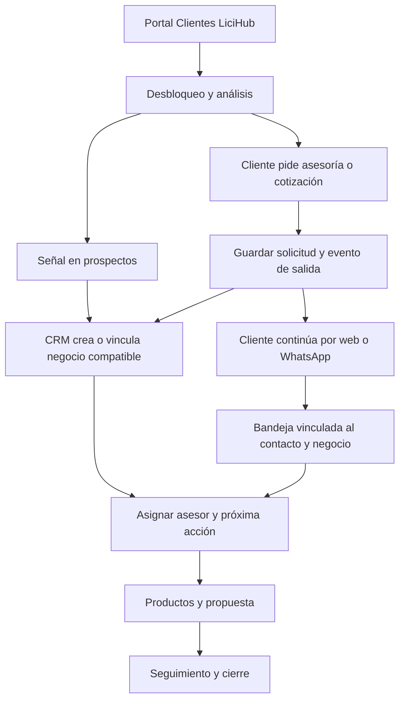
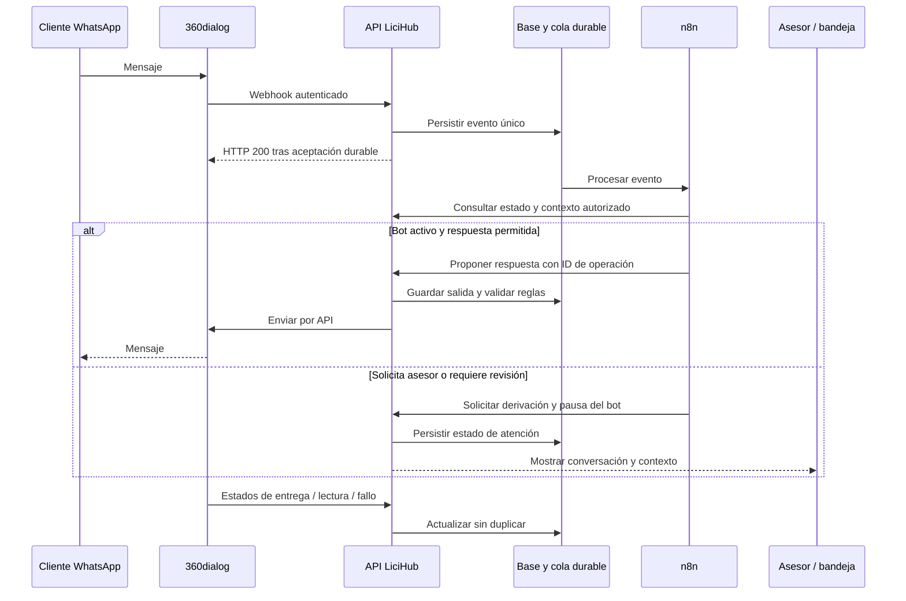

# LiciHub: requisitos revisados y funcionamiento de los flujos

Fecha: 19 de octubre de 2026. Nombre común: **LiciHub**, con dos áreas: **Portal Clientes** y **Portal Comercial / CRM**. El chatbot del diagrama se denomina provisionalmente **LiciChat**; su nombre final puede ser LiciHub Chat.

Este documento recoge lo solicitado por el usuario, lo explicado en los videos, lo visible en las capturas y la revisión de CRM/Bandeja de la referencia. Las propuestas de implementación se identifican como tales. Describe el próximo desarrollo; no declara conectadas las integraciones.

## 1. Cómo encender y revisar lo construido

El CRM está en `C:\Users\Favian\Downloads\testeos\lici-crm`. Abrir dos terminales PowerShell en esa carpeta:

```powershell
# Terminal 1: API y almacenamiento local
npm run api
```

```powershell
# Terminal 2: interfaz comercial
npm run dev
```

Entrar a **http://127.0.0.1:5174/**. Se necesitan ambos servicios: frontend en 5174 y API en 8001. Si aparece “No pudimos cargar el CRM”, comprobar primero la terminal de la API y pulsar “Reintentar conexión”. Si un puerto ya está ocupado por esta aplicación, reutilizar la instancia abierta. `Ctrl+C` detiene cada proceso.

Los datos ficticios se guardan en `backend/data/demo.json`; reiniciar no los borra. No hay que iniciar sesión en la demo. Es el flujo local construido el 16 de octubre, actualizado de marca; aún no es un espacio compartido conectado al CRM externo.

El Portal Clientes React se mantiene en `../interfaz_licitigo`, con frontend 5173 y API propia 8000. Allí `npm run dev` inicia su interfaz; el arranque/configuración de su backend se describe en su README. Los comandos anteriores corresponden específicamente al CRM.

## 2. Fuentes y grado de certeza

| Fuente | Qué se revisó | Alcance de la evidencia |
|---|---|---|
| Video `2026-09-30 09-37-05.mp4` | Duración 09:07; transcripción automática local del audio y revisión de escenas | Audio utilizable. La transcripción tiene nombres/normas imperfectos; los ejemplos numéricos no constituyen un tarifario |
| Video `2026-10-19 09-19-03.mp4` | Duración 14:30; pista de audio, escenas a lo largo del video y capturas ampliadas aportadas | Tiene pista AAC, pero es casi silenciosa: promedio aproximado −69 dBFS y detección automática de solo ~1,2 s de posible voz. No permite recuperar una explicación continua. Sus requisitos se obtienen de lo visible, no de una narración inventada |
| Diagrama adjunto, imágenes 1 y 3 | Portal Clientes → Comercial, entidades del negocio y dos ramas del chat | Evidencia visual directa del recorrido deseado |
| Capturas de HubSpot, imágenes 2 y 4–10 | Pipeline, ficha, llamadas y bandeja | Referencias funcionales/visuales. La presencia de un campo en HubSpot no lo convierte por sí sola en obligatorio |
| [CRM de referencia](https://buhbuhbuh.com/) | Inicio, CRM → Negocios, tablero, vista previa, ficha completa y Bandeja con conversación, comentarios y asociaciones | Navegación autenticada el 19/10. Se inspeccionaron controles sin enviar mensajes, realizar llamadas ni cambiar etapas/propietarios. No es una prueba integral del proveedor |
| Código local | CRM y Portal Clientes React, especialmente `DetalleDesbloqueo.tsx`, integración de análisis n8n y receptor CRM | Permite separar lo existente de lo que falta desarrollar |
| Documentación oficial 360dialog/n8n | API de mensajes, webhooks, ventanas, costes, credenciales y derivación humana | Consultada el 19/10/2026. No se contrató ni conectó ninguna cuenta |

Los videos y transcripciones se procesaron en este equipo; no se subieron a servicios de transcripción. Los originales permanecen en `C:\Users\Favian\Videos`. La evidencia derivada de revisión está en `.playwright-cli/media`, excluida de Git. No se incorporan datos personales de clientes ni credenciales de la referencia al documento.

### Lo explicado en el video con audio

| Tiempo aproximado | Requisito extraído |
|---|---|
| 00:00–00:49 | Vistas de empresas, negocios y contactos; contacto con nombre, teléfono y correo; negocio vinculado a la gestión del comercial |
| 00:50–01:41 | Lista y tablero interactivo de contactos; poder arrastrar; estados como entrante/por llamar, respondió y no respondió; consultar pendientes |
| 01:52–02:55 | Recepcionar la base de contactos de la web/fuente existente y separar la persona contactada de su empresa |
| 02:55–03:39 | Distinguir empresas contactadas de empresas con venta; estados comerciales entendibles; evitar copiar MQL/SQL sin necesidad |
| 03:39–04:29 | Vista de productos, utilizando el Excel comercial existente como fuente a proporcionar; negocio con valor, fechas, pipeline y responsable |
| 05:00–05:29 | Creación manual por el comercial y futura automatización; objetivo de CRM comercial propio |
| 05:30–06:08 | Botón de contactar ventas tras ver el resumen/análisis: entrada automática en Ingreso de lead con usuario/empresa, ISO y licitación interesada |
| 06:17–06:54 | Título, monto calculado a partir de productos, descuentos/ajustes autorizados, fecha de creación y comercial propietario |
| 06:54–07:42 | Asociar y editar elementos de pedido, elegir productos del catálogo y crear combinaciones/productos con nombre, descripción y precio unitario |
| 07:42–08:08 | Mantener el alcance comercial acotado; impuestos y frecuencia de facturación se mencionan como campos por evaluar, no como reglas cerradas |
| 08:34–08:58 | Mantener React y TypeScript y alinearse con el proyecto vigente `interfaz_licitigo` |

La mención de empresas “cerradas” se aclara inmediatamente con empresas contactadas/cotizadas/vendidas. **Propuesta:** conservar una sola empresa por identidad y ofrecer vistas por relación comercial; no esperar a vender para crearla ni duplicarla al cambiar de estado.

### Lo visible en el video del 19/10 y las capturas

- 00:20–03:10: tablero de negocios con etapa, propietario, importe, fecha y actividad; aparece un negocio procedente de WhatsApp.
- 03:20–04:40: diagrama de Portal Clientes, Portal Comercial y chat; la rama licitaciones pide RUC/departamento y ofrece cinco licitaciones; la rama certificados pide RUC/trabajadores en planilla y presenta cotización/ayuda comercial.
- Alrededor de 05:00: formulario de contacto de otro producto; sirve como referencia de captación, no implica añadir ese servicio al catálogo LiciHub.
- 05:40–09:20: ficha con propiedades, responsable, productos, contactos, empresa, historial y llamadas con resultado. Se ve procedencia “Webhook n8n WhatsApp”.
- 09:40–12:30: CRM de referencia, dashboard, búsqueda de 360dialog y bandeja WhatsApp.
- 12:50–14:10: etapas adicionales de seguimiento/espera/no respuesta/partners/consultas.

En las capturas se distinguen etapas de HubSpot: Ingreso de lead (0–24 h), Contacto (1–3 días), Cotización (2–10 días), Seguimiento (10–30 días), Venta y etapas laterales. La referencia viva tiene otros rangos: Cotización (2–5 días) y Seguimiento (5–10 días). **Los tiempos deben ser configurables y acordarse antes de convertirlos en SLA.**

## 3. Requisitos para avanzar, con diferencia frente a la demo

Prioridad P0: cierra el recorrido Portal → CRM; P1: operación comercial y mensajería; P2: ampliaciones. “Parcial” significa que existe una parte local comprobable.

| ID | Requisito | Fuente | Prioridad | Estado actual |
|---|---|---|---|---|
| R01 | Marca LiciHub y estilo común para ambos portales | Usuario | P0 | Marca visible actualizada; tokens de diseño compartidos por copia |
| R02 | Licitaciones por rubro/perfil, detalle, monto, departamento, entidad y bases | Diagrama + proyecto | P0 | Portal vigente tiene descubrimiento/desbloqueos; integraciones reales necesitan validación |
| R03 | Requisito ISO, recomendación IA y necesidad confirmada diferenciados | Diagrama + acuerdo previo | P0 | Parcial: análisis en Portal y contexto manual en CRM |
| R04 | Botón “Comunicarme con un asesor / Contactar ventas” guarda solicitud y contexto automáticamente | Audio 05:30 + usuario | P0 | Pendiente; no existe aún en `DetalleDesbloqueo.tsx` |
| R05 | Guardado fiable, asignación y confirmación al cliente sin duplicar el negocio | Acuerdo previo + propuesta técnica | P0 | Receptor CRM/idempotencia local existentes; falta emisor y entrega durable |
| R06 | Diferenciar señal por desbloqueo de asesoría/cotización solicitada | Acuerdo previo | P0 | Implementado localmente |
| R07 | Contactos con persona, empresa, teléfono, correo, procedencia y responsable | Audio 00:00–02:55 | P0 | Alta/listado parciales; falta edición y ficha propia |
| R08 | Contactos en lista y tablero con arrastre, estados y pendientes | Audio 00:50–01:41 | P1 | Pendiente; hoy solo lista |
| R09 | Empresas con vistas contactadas, cotizadas y clientes/ventas, sin duplicar identidad | Audio 02:55–03:39 | P1 | Vinculación por RUC/listado existentes; faltan vistas y edición |
| R10 | Negocios manuales/automáticos con título, fecha, propietario, etapa y valor | Audio 04:14–06:54 | P0 | Parcial; falta título editable/asignación a usuarios reales |
| R11 | Pipeline visual/lista, cambio por arrastre, filtros y antigüedad por etapa | Videos + referencia | P1 | Tablero/lista/filtros/cambio por selector existen; faltan arrastre y tiempos estructurados |
| R12 | Notas, reuniones, llamadas y siguiente acción visibles en historial | Videos + capturas | P1 | Registro básico local existente |
| R13 | Resultado de llamada: conectada, sin respuesta, ocupado, número incorrecto, mensaje dejado; dirección/duración | Video visual + imagen 9 | P1 | Pendiente; hoy solo texto libre de actividad |
| R14 | Catálogo con descripción, precio, paquetes y productos asociados al negocio | Audio 03:39 y 06:54 | P1 | Alta básica de servicio/PEN; faltan edición y paquetes estructurados |
| R15 | Propuestas con varias partidas, cantidades, descuentos, condiciones, impuestos y versiones | Audio + diagrama | P1 | Una partida/versiones/impresión local; faltan varias partidas y envío |
| R16 | Precio automático controlado y ajuste comercial con permisos/auditoría | Audio 06:17–06:48 | P1 | Cálculo por catálogo existente; faltan reglas de tarifa y aprobación |
| R17 | Bandeja WhatsApp compartida por asesor con búsqueda y filtros | Usuario + referencia | P1 | Pendiente |
| R18 | Conversación abierta/pendiente/cerrada, etiquetas, propietario y comentarios internos | Referencia + imagen 6 | P1 | Pendiente |
| R19 | Vínculo bidireccional conversación ↔ contacto ↔ empresa ↔ negocio | Referencia | P1 | Pendiente para mensajes; asociaciones comerciales básicas existentes |
| R20 | Mensajes texto/PDF/adjuntos, estados y respuestas rápidas | Referencia | P1 | Pendiente; medios pueden entregarse gradualmente |
| R21 | Ventana WhatsApp y plantillas aprobadas en interfaz y servidor | Referencia + 360dialog | P1 | Pendiente |
| R22 | 360dialog conectado por número/canal y webhooks autenticados | Usuario | P1 | Investigación realizada; cuenta/número/clave no provisionados |
| R23 | Chatbot que distingue licitaciones de certificados | Diagrama + usuario | P1 | Pendiente |
| R24 | Rama licitaciones: RUC/departamento → hasta cinco resultados → invitación a Portal | Diagrama | P1 | Pendiente; definir si son resúmenes o desbloqueos completos |
| R25 | Rama certificados: RUC, trabajadores en planilla y alcance → propuesta → ayuda humana | Diagrama | P1 | Pendiente; falta tarifario validado y datos de alcance |
| R26 | Pasar al asesor conservando contexto y pausar el bot | Diagrama + usuario + propuesta | P1 | Pendiente |
| R27 | n8n para orquestación, reintentos y avisos; CRM conserva datos y reglas | Usuario + propuesta técnica | P1 | Portal ya invoca n8n para análisis; no existe flujo comercial conectado |
| R28 | Dashboard administrador: captación, tiempos, pendientes, ventas y desempeño por asesor/origen/período | Diagrama + referencia | P1 | Mi día tiene totales locales; informe filtrable pendiente |
| R29 | Permisos de administrador/asesor/cliente, reasignación y trazabilidad | Necesidad operativa | P0 | Guardas preparadas; falta validar cuentas reales y alcance por asesor |
| R30 | Cierre comercial separado de entrega, cobro, renovación y atención | Acuerdo previo + capturas | P1/P2 | Ganado/perdido locales; postventa/cobro pendientes |
| R31 | Importación de base de contactos y Excel de productos con revisión de duplicados | Audio 01:52 y 03:54 | P2 | Pendiente; no se proporcionó el Excel en este turno |
| R32 | Mantener React/TypeScript y contratos comunes con el proyecto web | Usuario + audio 08:34 | P0 | Dos proyectos locales del mismo stack; unificar componentes/contratos y organización del repositorio sigue pendiente |

## 4. Cómo funcionará el recorrido completo

### Flujo A: descubrir una licitación y generar una señal

1. El cliente entra al Portal Clientes LiciHub y consulta procesos compatibles con su empresa.
2. Desbloquea uno y ve monto, entidad, departamento, bases y análisis ISO cuando esté disponible.
3. El backend registra la señal con empresa, licitación, fecha, fuente y estado del análisis. Un análisis pendiente puede enriquecerse después, sin crear otra señal.
4. El CRM la muestra en “Señales LiciHub”. El requisito de las bases y una recomendación se guardan en campos separados; ninguno demuestra por sí solo que a la empresa le falte la certificación.
5. Sin solicitud del cliente o confirmación del asesor, queda en prospección. Si ya hay negocio abierto compatible, se agrega como contexto conservando su tipo.

### Flujo B: botón de hablar con un asesor → CRM

1. En el detalle/análisis aparece **“Comunicarme con un asesor”**. El cliente elige asesoría o cotización y confirma servicio/canal de contacto.
2. Si ya tiene perfil, el sistema recupera empresa y contacto; no obliga a escribirlos otra vez. Permite corregir lo necesario. Si no ha iniciado sesión, recoge los datos mínimos y valida el envío antes de confirmar la solicitud.
3. El Portal envía a **su backend** la intención. El servidor deriva identidad/RUC desde la sesión y comprueba que el cliente tenga acceso a esa licitación/análisis. No confía en un ID de empresa enviado por el navegador.
4. Guarda la solicitud y un evento de salida durable en la misma transacción. Muestra **“Solicitud recibida”** con identificador; si falla el guardado, conserva el formulario y permite reintentar.
5. Un proceso entrega el evento al CRM. Crea/vincula empresa y contacto, reutiliza un negocio abierto de la misma necesidad o crea uno en Ingreso de lead. Se conserva la señal anterior, sin convertirla en “solicitud”.
6. Asigna propietario mediante una regla explícita. Propuesta inicial: conservar dueño del negocio compatible; si es nuevo, cola “Sin asignar” hasta configurar reparto. Nunca mostrar un asesor asignado si todavía no lo hay.
7. Programa primera atención y registra contexto: ISO(s), licitación y vínculo de origen, análisis/fecha, RUC, persona, canal y comentario del cliente.
8. Si el cliente elige WhatsApp, ofrecer **“Continuar por WhatsApp”** después de guardar. El enlace lleva una referencia opaca, sin insertar RUC/correo completos en la URL. El lead queda registrado aunque no abra WhatsApp o no envíe el texto.

**Diferencia práctica:** abrir un enlace `wa.me` no prueba que el cliente haya enviado un mensaje. Guardar el lead no abre la ventana de WhatsApp; esa ventana depende de una interacción entrante válida en el canal. El widget web puede permitir seguir la conversación directamente en el sitio en una entrega posterior.



### Flujo C: entrada por WhatsApp y bandeja

1. El cliente escribe al número comercial. 360dialog entrega el evento al webhook de LiciHub.
2. El receptor autentica el origen, persiste el evento y responde rápidamente. Un trabajador procesa el mensaje y evita duplicados por canal/ID del proveedor.
3. Crea o vincula la identidad de mensajería y una conversación. Un teléfono compartido por varios contactos no fusiona automáticamente personas ni empresas; los casos ambiguos quedan para revisión.
4. Un saludo o consulta general abre conversación/prospecto. Una petición explícita de certificado, asesor o cotización abre/vincula negocio. Una pregunta sobre uso del portal se deriva a soporte sin crear una venta automáticamente.
5. La conversación aparece en **Sin asignar**, **Asignadas a mí** o **Todas**, con filtros de estado, etiquetas y no leídos. Al asignar, el propietario de conversación y el de negocio se coordinan según una política visible.
6. El asesor ve historial y ficha lateral; distingue **WhatsApp** de **Comentario interno**. Un comentario nunca se manda al cliente.
7. Cada envío pasa por el backend, que verifica permisos, ventana, plantilla y solicitud de baja; registra quién lo envió. El selector filtra plantillas por finalidad/servicio y exige elección explícita: no utiliza por defecto una plantilla de otro producto. “En cola/aceptado” no equivale a “Entregado”. Los webhooks actualizan enviado, entregado, leído y fallido sin retroceder por eventos desordenados.
8. Cerrar la conversación no marca el negocio Ganado. Un nuevo mensaje puede reabrir la conversación conservando asociaciones. Otro servicio puede originar un negocio adicional.

### Flujo D: chatbot de licitaciones

El bot se presenta como asistente virtual y ofrece **Licitaciones**, **Certificados** y **Hablar con asesor**. En licitaciones solicita RUC y departamento, recupera datos del Portal mediante API y muestra hasta cinco procesos compatibles con referencia/enlace. No inventa procesos ni utiliza una hoja paralela como fuente de verdad.

El diagrama habla de “cinco licitaciones gratis”, pero no define si son cinco resultados resumidos o cinco accesos completos. **Propuesta inicial:** cinco resúmenes con acceso al Portal para consultar más; mantener separado ese cupo del saldo actual de desbloqueos hasta definir la regla comercial. El control debe hacerse en servidor, con límites contra abuso, y respetar el acceso de la empresa a sus datos.

Consultar licitaciones no implica querer comprar ISO. El bot pregunta si desea ayuda cuando el contexto lo justifique; solo registra una solicitud comercial cuando el cliente la acepta.

### Flujo E: chatbot de certificados y cotización

1. Pregunta RUC, norma(s) de interés y cantidad de trabajadores en planilla, tal como indica el diagrama.
2. Recoge el alcance mínimo que requiera el tarifario: actividad, sedes, servicio inicial/seguimiento/renovación y otros factores confirmados por el equipo. El número de trabajadores por sí solo no permite prometer cualquier precio.
3. Consulta catálogo/reglas del CRM. La IA puede explicar o extraer datos; el cálculo de precios, descuentos y condiciones es determinista y auditable.
4. Si existe regla aprobada y datos suficientes, genera una propuesta versionada con vigencia/alcance. Si faltan datos o la combinación no está tarifada, muestra estimación identificada como tal o solicita revisión humana.
5. Presenta **“Quiero que un asesor me explique la propuesta”** y deriva con el contexto completo. La política para emitir automáticamente una cotización formal queda pendiente de aprobación comercial; primera entrega propuesta: borrador revisado por asesor.

### Flujo F: derivación humana y retorno al bot

Estados propuestos de atención: `bot_activo → esperando_asesor → asesor_activo → cerrada`. El cliente puede pedir una persona en cualquier momento; también se deriva por datos insuficientes, excepción de precio o baja confianza.

Al solicitar derivación, se guarda el estado y se pausa la respuesta automática antes de notificar al equipo. El asesor recibe resumen, respuestas, licitación/ISO y propuesta; el cliente conserva el mismo hilo. Fuera de horario se informa el plazo/horario real configurado, sin prometer respuesta inmediata. El bot se reactiva solo mediante una acción explícita del asesor o una política acordada; nunca responde simultáneamente por falta de sincronización.

### Flujo G: trabajo del comercial y cierre

Contactos tendrán su propio estado de gestión (propuesta: **Entrante → Por contactar → Contactado**, con **No responde**, **Datos incorrectos** y **Descartado** como resultados/estados recuperables). Las llamadas registran resultado, nota, fecha, dirección y duración si se dispone del dato. Grabar o llamar desde el sistema requiere una integración de telefonía adicional; registrar una llamada no la realiza.

El negocio sigue etapas comerciales: **Ingreso de lead → Contacto → Necesidad validada → Cotización enviada → Seguimiento → Ganado / Perdido**. Propuesta: **Stand by** exige fecha de reactivación; **No responde** exige siguiente intento; las consultas de soporte y posibles partners se gestionan como tipos/colas propios para no distorsionar el embudo de ISO. Las capturas sirven de referencia, no obligan a copiar todas las columnas ni sus duplicados.

Al cotizar se eligen varias partidas o un paquete desglosable del catálogo, se calculan cantidades/descuentos/impuestos y se guarda una versión. Enviar una propuesta, aceptar una venta, cobrar y entregar un certificado son hitos diferentes. Ganado crea la siguiente tarea de postventa y conserva el asesor responsable o deriva al área correspondiente según regla acordada.

## 5. Qué aporta 360dialog y cómo usar n8n

### Integración propuesta

**360dialog** proporciona acceso a WhatsApp Business Platform y al transporte de mensajes; la bandeja de trabajo, permisos, clientes, negocios y reglas comerciales se implementan en LiciHub. La API permite texto, medios y plantillas mediante `D360-API-KEY`; la clave queda en el servidor. [Referencia oficial de mensajes](https://docs.360dialog.com/docs/messaging-api/api-reference/messages).

**n8n** coordina tareas como clasificar intención, consultar servicios LiciHub, preparar una respuesta, derivar y avisar. Usar **Webhook + HTTP Request** para 360dialog. El nodo nativo “WhatsApp Business Cloud” de n8n documenta credenciales Meta; una clave de 360dialog no se debe asumir intercambiable. Si se eligiese Cloud API directa de Meta, podría usarse ese otro camino con sus credenciales. [Webhook](https://docs.n8n.io/integrations/builtin/core-nodes/n8n-nodes-base.webhook/), [HTTP Request](https://docs.n8n.io/integrations/builtin/core-nodes/n8n-nodes-base.httprequest/), [credenciales WhatsApp n8n](https://docs.n8n.io/integrations/builtin/credentials/whatsapp/).

El Portal ya invoca n8n para analizar bases en `backend/app/desbloqueos.py`; ese flujo no es el chatbot comercial. La nueva automatización requiere contrato y credencial propios. No se inspeccionó una instancia n8n del otro sistema mencionado por el usuario.



Ventajas de esta división: el lead y el historial sobreviven si n8n está detenido; todas las salidas verifican si un asesor ya tomó la conversación; el proveedor de WhatsApp puede cambiar sin reescribir el CRM. Son decisiones propuestas de arquitectura, aún no código entregado.

### Reglas y costes comprobados

- La ventana de servicio se abre con un mensaje del cliente y dura 24 horas; fuera de ella se utilizan plantillas aprobadas. Un clic en el botón web o una respuesta saliente del asesor no sustituyen el mensaje entrante. La regla se aplica en backend y se muestra en bandeja. [Ventanas y facturación](https://docs.360dialog.com/docs/get-started/pricing/free-vs-billed-messaging).
- El plan estándar publicado por 360dialog es **49 EUR o 59 USD mensuales por canal**, más consumo variable de WhatsApp y posibles extras. Presupuestar también alojamiento/n8n y consumo del modelo del bot. La activación inicia la facturación. No se contrató nada. [Precios oficiales](https://docs.360dialog.com/docs/get-started/pricing).
- **No presupuestar “todos los mensajes dentro de 24 h son gratis”.** La versión de documentación abierta durante esta revisión describe cargos por mensajes de servicio; los extractos indexados consultados muestran información anterior diferente y la página tiene una discrepancia interna sobre la ventana gratuita de campañas. La tarifa exacta por destino/categoría y beneficios de campaña deben confirmarse en las rate cards/Hub vigentes antes de contratar. La página Meta no pudo comprobarse directamente en esta sesión; no se fija una tarifa por mensaje para Perú.
- Antes de iniciar mensajes se registra autorización del destinatario y su preferencia de canal; se respeta la baja. Tener un teléfono en una base no basta para iniciar comunicaciones. La autorización de atención solicitada y la de campañas se guardan separadas. [Opt-in oficial](https://docs.360dialog.com/docs/messaging/overview/opt-in).
- El receptor usa HTTPS, acepta el evento de forma durable y responde dentro de los límites del proveedor; el procesamiento lento del bot ocurre después. Contemplar repetidos, caídas y eventos fuera de orden. [Webhooks 360dialog](https://docs.360dialog.com/docs/messaging/webhook).
- Si desean conservar el WhatsApp Business móvil con el mismo número, evaluar **Coexistence** y su elegibilidad/limitaciones antes de migrar. No asumir que conserva toda funcionalidad o todos los dispositivos asociados. [Coexistence](https://docs.360dialog.com/docs/resources/phone-numbers/coexistence).
- n8n documenta patrones de derivación a una persona; el bloqueo real del bot y la propiedad del hilo deben persistir en LiciHub y comprobarse otra vez al enviar. [Derivación humana n8n](https://docs.n8n.io/build/integrate-ai/ai-examples/set-a-human-fallback-for-ai-workflows.md).

## 6. Cambios de datos y contratos necesarios

Para el piloto compartido/mensajería se propone normalizar PostgreSQL/Supabase. El documento JSONB por espacio de la demo no es suficiente como almacén definitivo de conversaciones concurrentes.

Entidades necesarias: espacios/equipos, usuarios comerciales y asignaciones; empresas/contactos/identidades de canal; solicitudes y señales; negocios con historial estructurado de etapas; catálogo/paquetes, partidas y versiones; conversaciones/participantes/mensajes/notas/etiquetas; permisos de contacto; eventos entrantes/salientes, tareas y entregas de automatización. Mensajes y cambios de etapa conservan IDs/actor/fechas y fuente.

Eventos propuestos: `tender.unlocked`, `iso.analysis.updated`, `sales.assistance.requested`, `sales.quote.requested`, `whatsapp.message.received`, `whatsapp.message.status_updated`, `conversation.handoff_requested`, `conversation.assigned`, `quote.ready`, `deal.won`. Cada contrato tendrá versión, `event_id`, espacio, ocurrencia, correlación y deduplicación.

La API actual `/api/crm/events` solo recibe altas de entrada y exige `origin: "Lici"`. **Ese valor técnico se conserva por compatibilidad**, aunque la interfaz ya muestre LiciHub; este documento no modifica el esquema remoto. El contrato futuro debe añadir IDs reales, varias ISO, referencia al análisis/licitación y actualizaciones, además de un receptor específico para mensajes. No enviar directamente payloads WhatsApp al receptor comercial actual.

El cliente final consulta únicamente sus solicitudes y conversaciones; el comercial accede a su ámbito y administración al del equipo. Verificación de cuenta LiciHub no implica membresía del CRM. n8n usa credenciales de integración acotadas y nunca decide permisos a partir del texto de un mensaje.

## 7. Orden de desarrollo recomendado

| Entrega | Resultado comprobable | Dependencias |
|---|---|---|
| 1. Datos y acceso compartidos | Espacio de prueba Supabase, entidades/IDs y permisos; solicitud guardada más evento durable; conflictos y duplicados controlados | Configuración de entorno y cuentas de prueba |
| 2. Portal → Comercial | Botón asesor/cotización en `DetalleDesbloqueo`, confirmación al cliente, señal/solicitud vinculadas y negocio visible al comercial | Entrega 1; puede avanzar sin contratar WhatsApp |
| 3. Gestión comercial | Contactos con estados/tablero, edición de empresas/contactos, usuarios asignables, resultado de llamadas, varias partidas y paquetes | Datos comerciales y Excel/tarifario |
| 4. Bandeja 360dialog | Recibir/responder texto, asignar, comentar, vincular negocio, ventanas/plantillas/estados de entrega; después PDF/otros medios | Número/WABA, clave, HTTPS, plantillas y destinatarios de prueba |
| 5. Bot n8n | Dos ramas, API de datos/precios y traspaso humano sin respuestas simultáneas | Bandeja, estado de atención y reglas/tarifario |
| 6. Administración | SLA configurables, avisos, informes por período y seguimiento postventa | Historial estructurado y operación validada |

Primero conviene entregar **Portal → CRM sin depender de WhatsApp**: demuestra el valor principal y deja lista la conversación para conectarla. Investigar/provisionar el número y diseñar bandeja/bot puede avanzar mientras se completa ese flujo.

### Escenarios mínimos de aceptación

1. Desbloqueo sin petición → señal, cero negocios nuevos.
2. Solicitud de asesoría sobre esa licitación → un negocio y contexto completo; doble clic/reintento no duplica.
3. Abrir WhatsApp y abandonarlo → solicitud conservada, sin inventar mensajes ni ventana abierta.
4. Mensaje “hola” → conversación/prospecto; petición ISO → negocio compatible, conservando origen y vínculos.
5. Webhook repetido → un mensaje; estados desordenados no hacen retroceder de leído a enviado.
6. Asesor toma conversación mientras n8n prepara respuesta → el bot descarta esa salida antes de enviarla.
7. Ventana cerrada → bloquea mensaje libre, permite plantilla válida y registra el resultado real.
8. Comentario interno → visible al equipo, nunca enviado al cliente.
9. Dos empresas usan un teléfono → revisión de identidad, sin fusionar automáticamente.
10. Precio no tarifado/faltan datos → revisión humana, sin cotización inventada por IA.
11. Cerrar conversación → negocio mantiene su etapa; ganar venta → postventa/cobro siguen hitos independientes.
12. n8n/proveedor caído → solicitud/mensaje aceptado permanece pendiente de procesamiento con error/reintento visible.

## 8. Decisiones que faltan para activar las siguientes entregas

- Número comercial, titular de WABA/360dialog y si se conserva la app móvil; acceso a entorno de prueba y dominio HTTPS.
- Regla de reparto, horario, alcance de visibilidad por asesor y objetivos de atención por etapa; los rangos del video y la referencia difieren.
- Excel de productos vigente, descripción de paquetes, factores de precio, descuentos y aprobaciones. Definir qué propuesta puede emitir el bot y cuál requiere asesor.
- Regla exacta de cinco licitaciones gratis y vínculo con desbloqueos/saldo del Portal.
- Ubicación/administración de n8n y modelo IA; acceso al flujo del otro sistema si desean reutilizarlo. No basta con copiar un webhook de análisis ya configurado.
- Política de consentimientos, retención, adjuntos y grabación de llamadas; proveedor de telefonía solo si se quiere llamar/grabar desde el CRM.
- Organización conjunta del código React: contratos/componentes comunes y posible monorepo. Mantener las rutas actuales hasta realizar esa reorganización expresamente.

Estas decisiones no impiden construir el botón web y la recepción comercial en un entorno de prueba. La nueva mensajería, el bot y los cambios de datos descritos se mantienen como próximos desarrollos; en esta revisión se entregan el análisis, la marca visible y el sistema local encendido.
