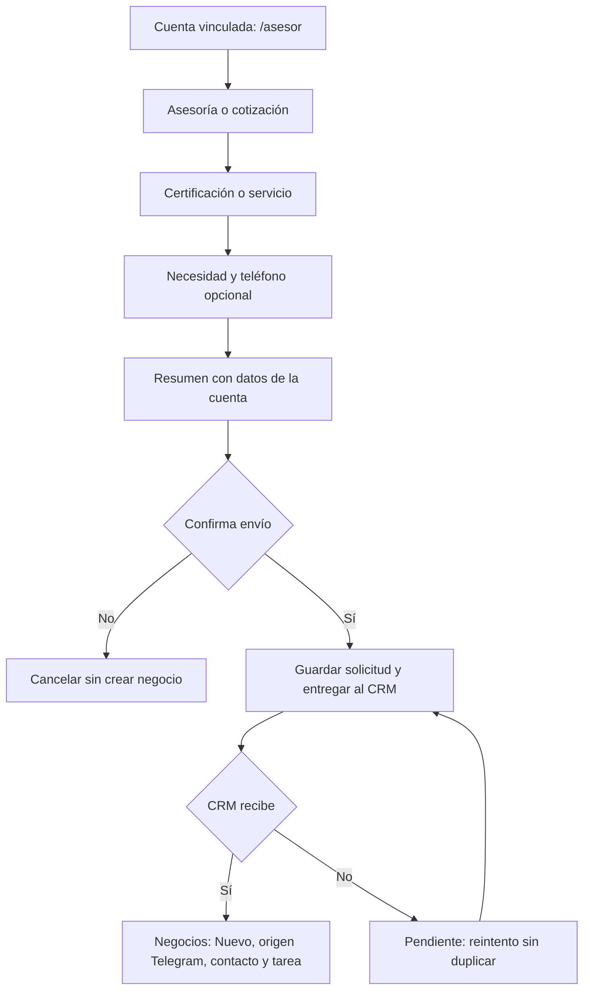

# Asesoría comercial desde el portal y Telegram

Actualización: 27/10/2026. Portal y CRM viven en `portal/` y `crm/` de la misma rama `main`. [Instalación conjunta](../../README.md).

## Cuándo se crea un negocio

Solo al confirmar una solicitud comercial. Registrarse, desbloquear una licitación, consultar el bot y recibir recomendaciones no envían señales al CRM.

En el portal: abrir una licitación ya desbloqueada, pulsar **Hablar con un asesor** y después **Confirmar solicitud**. El servidor verifica el desbloqueo de la cuenta y toma empresa, RUC, nombre y correo desde datos autenticados. Envía la referencia de la licitación; no afirma que la empresa carece de una ISO.

En Telegram: conectar el chat desde Mi perfil del portal. En el chat privado usar `/asesor` o `/asesor ISO 9001`; también reconoce «quiero hablar con un asesor». El bot reutiliza empresa, RUC, nombre y correo de la cuenta. Pregunta si se necesita orientación o cotización, permite elegir ISO/paquete u otro servicio, pide una breve descripción y ofrece añadir teléfono propio o usar el correo. Muestra el resumen y solicita **Enviar solicitud** o **Cancelar**. Compartir un contacto de otro usuario no se acepta. No guarda la solicitud en la cola ni envía datos al CRM antes de confirmar. Funciona también si las alertas están pausadas. La confirmación vence a los 15 minutos; tras reiniciar el bot se debe pedir una nueva si aún no se confirmó. Una solicitud confirmada y guardada sí sobrevive al reinicio.

`/omitir` permite precisar la necesidad con el asesor; `/cancelar` cancela una captura aún no confirmada. `/estadoasesoria` muestra el estado de entrega de la última solicitud de la cuenta vinculada. Una petición ya confirmada no se revoca desde el botón Cancelar. Las preguntas recogen los datos para atención comercial, sin calcular automáticamente precios ni enviar una cotización definitiva.



En el CRM: aparece en **Negocios**, etapa **Nuevo**, responsable **Sin asignar**, con contacto, procedencia y tarea de primera atención a 24 horas. Se reutiliza un negocio abierto de la misma empresa y servicio. Cada solicitud conserva su canal en la ficha aunque el negocio ya existiera. La interfaz actualiza los datos cada 30 segundos mientras está visible y al recuperar el foco.

Esto solicita contacto del equipo; no abre una conversación en vivo ni implementa una bandeja para responder por Telegram desde el CRM. El asesor puede usar el correo de la cuenta o el enlace público de Telegram registrado, cuando exista. La asignación automática a asesores reales sigue pendiente.

## Activación

1. Para una base aún no actualizada, aplicar manualmente `crm/backend/migrations/008_origen_telegram.sql` en Supabase una sola vez. El usuario confirmó que ya fue aplicado en el proyecto compartido. Es repetible, conserva registros y permisos; no requiere volver a provisionar el espacio ni importar datos de demostración.
2. En `backend/.env` del CRM configurar `CRM_INGEST_KEY` con un secreto independiente.
3. En `backend/.env` de este portal configurar el mismo `CRM_INGEST_KEY` y `CRM_API_URL`. La URL es el origen de la **API** del CRM, por ejemplo `http://127.0.0.1:8001`, sin `/api/crm/events`. Si ambos procesos están en distintos equipos, localhost no comunica esos equipos: usar un servidor HTTPS alcanzable por el emisor y configurar su host en el CRM. No usar la URL del frontend como si fuera la API.
4. Reiniciar la API del CRM, la API del portal y el proceso del bot. Las claves permanecen en los servidores, nunca en variables `VITE_*` ni en Git.

Desde la raíz del portal, en terminales separadas:

```powershell
# API del portal
.\backend\.venv\Scripts\python.exe -m uvicorn app.main:app --host 127.0.0.1 --port 8000 --app-dir backend
```

```powershell
# Interfaz del portal: http://localhost:5173/
$env:API_URL = "http://127.0.0.1:8000"
npm run dev
```

```powershell
# Bot; solo una instancia por token. Las alertas existentes también se ejecutan.
cd backend
.\.venv\Scripts\python.exe -m app.bot
```

Desde la raíz general: `npm run crm` (o `npm start` para ambas aplicaciones). El portal y el bot comparten `CRM_OUTBOX_FILE` en una instalación. Si se despliegan separados, cada cola necesita almacenamiento persistente y un proceso activo que la reintente; la deduplicación final sigue en el CRM.

## Fallos y recuperación

Si el CRM responde 503 y **Espacio e integraciones** muestra **Recepción deshabilitada**, su API no tiene `CRM_INGEST_KEY` cargada. No implica que el cliente haya omitido datos ni que deba repetir la solicitud. Desde la raíz del repositorio, en **CMD o PowerShell**, enlazar las dos configuraciones locales sin mostrar claves:

```powershell
npm run enlazar
```

Alternativa desde `portal/backend`: `.\.venv\Scripts\python.exe -m app.configurar_crm --crm ..\..\crm`. La herramienta requiere ambos `.env` existentes, conserva las claves de Supabase y reutiliza la clave de integración del receptor; si está vacía reutiliza la del portal o genera una nueva. No imprime el valor. Reiniciar **API CRM, API portal y bot** para cargarla. Esto enlaza los proyectos indicados en este equipo; si el emisor apunta a un servidor remoto se debe configurar la clave de ese servidor de forma privada.

Comprobar la conexión sin crear un negocio, desde `portal/backend`:

```powershell
.\.venv\Scripts\python.exe -m app.asesorias diagnostico
```

El diagnóstico envía una intención inválida que el receptor rechaza antes de guardar; comprueba recepción/clave, no escritura en Supabase. Después de corregir la configuración, recuperar hasta 20 solicitudes pendientes sin esperar su próximo reintento:

```powershell
.\.venv\Scripts\python.exe -m app.asesorias reintentar-pendientes
```

Conservar la misma cola del equipo que recibió la solicitud original. Una cola local no se copia con Git. Los mensajes 503 ahora distinguen recepción deshabilitada, rechazo del origen por SQL 008 y fallo de almacenamiento sin exponer datos de clientes. El usuario informó que SQL 008 ya se aplicó; no hace falta otra migración para este flujo de preguntas.

La solicitud se guarda en `backend/data/asesorias.sqlite3` antes de intentar enviarla. Una caída del CRM muestra «guardada y pendiente de entrega», nunca una confirmación falsa. API y bot reintentan con espera creciente entre 30 segundos y una hora. La cola procesa hasta 20 entradas por ronda y conserva identificador y contenido. No guarda claves ni conversaciones; al confirmar recepción borra el contenido de contacto de la cola y conserva el recibo de deduplicación.

401/403/422 y redirecciones se consideran errores de configuración o datos y requieren revisión; no se descartan. Timeouts, 409, 429 y 5xx se reintentan. Tras corregir la configuración, desde `backend`:

```powershell
.\.venv\Scripts\python.exe -m app.asesorias estado
.\.venv\Scripts\python.exe -m app.asesorias reintentar IDENTIFICADOR_DE_SOLICITUD
```

El estado operativo muestra identificadores, intentos y códigos de error; no muestra correos ni mensajes. Respaldar el archivo de cola y proteger su directorio. La cola local no se comparte automáticamente entre computadoras ni sustituye una cola distribuida para producción.

## Pruebas

```powershell
cd backend
.\.venv\Scripts\python.exe -m unittest discover -s tests -v
```

Prueba conjunta desde la raíz del portal, con ambas aplicaciones del mismo repositorio:

```powershell
.\backend\.venv\Scripts\python.exe scripts/probar_integracion_crm.py --crm-path ..\crm
```

Utiliza bases temporales y los receptores reales de ambas aplicaciones; simula únicamente identidad, lectura de perfil y transporte de Telegram. Comprueba confirmación, CRM apagado, recuperación, reentrega y origen web, sin crear usuarios ni contactar clientes.

Prueba real: una vez habilitada la recepción y con una sola instancia del bot, completar `/asesor`, confirmar el resumen y comprobar Negocios filtrado por Telegram. Verificar contacto, teléfono si se indicó, tipo, necesidad y tarea. Consultar `/estadoasesoria` si la entrega estaba pendiente. Revisar también el botón con una licitación realmente desbloqueada. Las pruebas locales no sustituyen la comprobación en el equipo del operador.

Referencias: [Telegram Bot API: botones](https://core.telegram.org/bots/api#keyboardbutton), [contactos](https://core.telegram.org/bots/api#contact) y [tareas periódicas del bot](https://docs.python-telegram-bot.org/en/latest/telegram.ext.jobqueue.html).
